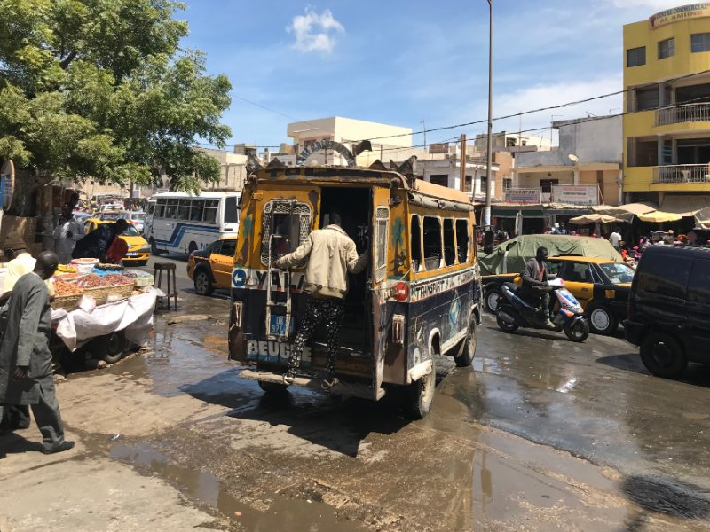
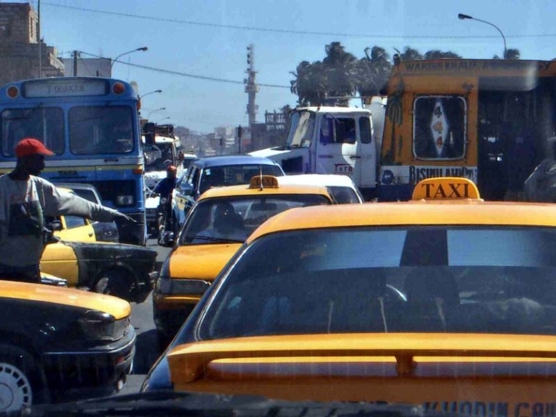
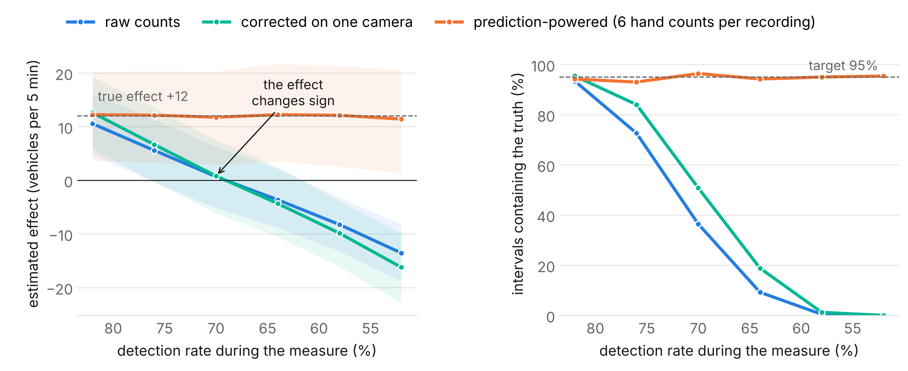
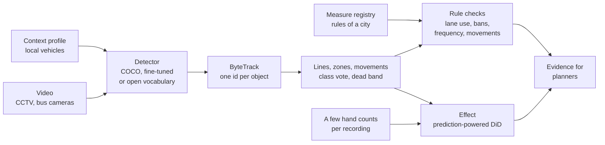

# Traffic Vision Senegal

[](https://github.com/princiliadaci/traffic-vision-senegal/actions/workflows/tests.yml)

**Did the rule work? Measuring urban mobility policies from video in African
cities, with honest uncertainty and without identifying anyone.**

Cities change their traffic rules all the time: a temporary plan for an event,
a dedicated bus corridor, a ban on motorcycle taxis, roads closed on Sunday
mornings. These rules are rarely evaluated with traffic counts, because
African cities have few loop detectors, while cameras are already on the
roads. Traffic Vision turns that video into evidence: who used a reserved
lane, how many banned vehicles still passed, whether a promised bus frequency
holds, where traffic went when a road closed, and whether the change is larger
than what the city saw everywhere else.

The method is general; a city or a policy is described in two small files. The
worked example is the **Dakar 2026 Youth Olympic Games** (31 October to 13
November 2026), whose 166 traffic measures were surrounded by a lot of
technology but, as far as public sources show, by no measurement of whether
the rules themselves worked. Registries are also ready for the **Dakar BRT
corridor**, the **okada ban in Lagos** and the **car-free days of Kigali**.

<table>
<tr>
<td width="25%"></td>
<td width="25%"></td>
<td width="25%"></td>
<td width="25%"></td>
</tr>
<tr>
<td><sub>A reserved lane: the BRT at Grand Dakar, May 2026. <i>4MAPS, CC BY 4.0</i></sub></td>
<td><sub>Car rapide, motorbike, taxis and a bus in HLM: the mix a Dakar model must learn. <i>Lisa Coulaud, CC BY-SA 4.0</i></sub></td>
<td><sub>Mixed traffic, taxis and buses. <i>Ji-Elle, public domain</i></sub></td>
<td><sub>The TER, backbone of the Games transport plan. <i>S. A. Gueye (VOA), public domain</i></sub></td>
</tr>
</table>

## Research question

> Can existing video be turned into credible, privacy-preserving evidence of
> the effect of a mobility rule in an African city, for any city and any kind
> of rule, and how uncertain is that evidence once the errors of the neural
> network are carried through to the conclusion?

Research note, related work and references: [`docs/research.md`](docs/research.md).
Apply it to your city: [`docs/adapt_to_your_city.md`](docs/adapt_to_your_city.md).

## What this project adds

1. **A rule-first framework.** Rules are described in measure registries
   ([`measures/`](measures)): place, dates, hours, recurrence, classes allowed
   or banned, the indicator a camera can produce, what it cannot see, and
   sources. Five kinds of rule (reserved lane, ban on a class, banned
   movement, promised service frequency, closure), seventeen sourced measures
   in four registries and three countries.
2. **Context profiles** ([`contexts/`](contexts)): the local vehicles (car
   rapide, Ndiaga Ndiaye, jakarta, charrette; danfo, keke, okada; moto-taxi),
   the class each one is counted in, the labels of open-vocabulary models that
   may catch it, and the data protection law. A new city is a new file, not
   new code.
3. **A test of what detectors see in Dakar.** A closed-vocabulary model (COCO)
   and an open-vocabulary model (YOLOE, 4,585 classes) both call the car
   rapide a truck. Under a truck ban, that error creates offences that never
   happened.
4. **Prediction-powered difference-in-differences.** A few minutes of hand
   counting in each recording correct the network's counts, even when cameras
   do not see alike or a local vehicle is confused with a banned class, with
   intervals that stay honest when traffic is autocorrelated.
5. **A design tool** that says how many hours and days to film before anyone
   asks for footage.
6. **Privacy by design**: anonymous tracks and classes only, no plates, no
   faces. It measures the use of the road, not offenders.


## First results

**What a camera can see.** Of the seventeen measures, four are fully
observable on video, eleven partly and two not with current models. The blind
spots are the same in every city: permits and status (accredited vehicles,
commercial or private motorcycle), legal categories (the 3.5 tonne limit for
trucks) and local vehicles absent from training data.

**What detectors see in Dakar.** On four photos of Dakar with hand-drawn
boxes, the COCO model put 9 of 13 vehicles in the right class and the
open-vocabulary model 11 of 13. Both called the car rapide a truck in every
photo where it appears; a one-shot visual prompt did not transfer to another
photo. Full table: [`docs/results/open_vocabulary_probe.md`](docs/results/open_vocabulary_probe.md).


**What that does to a conclusion, and how to fix it.** In 1,000 simulated
studies per scenario, where the truth is known:

| Situation | Network counts alone | With a few hand counts per recording |
|---|---|---|
| A closure adds 12 vehicles per 5 min; detection falls from 82% to 70% during the measure | effect 0.7, interval contains the truth in 35% of studies | effect 11.8, in 94% |
| A truck ban: 12 trucks per hour still pass, half the car rapides are seen as trucks | 59.6 trucks per hour, in 0% | 12.0 trucks per hour, in 92% |



When the camera sees less during the measure, raw counts reverse the
conclusion: below 70% detection the closure seems to reduce traffic. The
prediction-powered estimate stays at the true effect.

A before/after comparison mistakes the city-wide change for the effect, raw
counts shrink it, and ordinary intervals are too narrow when traffic is
autocorrelated. Honest intervals are wide: to detect a +20% change on a street
with 60 vehicles per 5 minutes, three days of eight hours per period give a
93% chance, one day of two hours 22%. Details:
[`docs/results/simulation.md`](docs/results/simulation.md).

## Why it matters

- **Road data is thin.** ANASER, Senegal's road-safety agency, recorded 868
  deaths and 15,407 crashes in 2025, while the World Health Organization
  estimates more than 3,500 road deaths a year in Senegal.
- **Two-wheelers are central.** They account for 38% of road crashes
  according to ANASER, and generic models and manual surveys handle them
  poorly.
- **Big investments deserve measurement.** The electric BRT runs 18.3 km from
  Guédiawaye to Petersen; the TER reached the airport in September 2026.
  Elsewhere, Kigali's car-free days were evaluated with air-quality monitors
  and the Lagos okada ban with surveys, not with traffic counts.

## The pipeline



- **Detection**: eight core classes (pedestrian, bicycle, motorcycle,
  tricycle, car, bus, truck, cart). Labels from any model (COCO, BDD100K,
  VisDrone, YOLOE prompt-free, or a model fine-tuned on local images) are
  mapped by name, with the local names of the context profile first. A person
  on a motorbike is a rider, not a pedestrian, so *jakarta* traffic does not
  inflate pedestrian counts.
- **Tracking**: ByteTrack keeps one identity per object; the class of a track
  is the one with the highest summed confidence.
- **Counting**: once per object when its contact point crosses a line (with a
  dead band), uses a zone, or goes from one named line to another (turning
  movements).
- **Analysis**: flows, passenger car equivalents, rule checks, and the effect
  of a measure with its interval.

Method and data schema: [`docs/methodology.md`](docs/methodology.md).

## Quick start

```bash
git clone https://github.com/princiliadaci/traffic-vision-senegal.git
cd traffic-vision-senegal
python -m venv .venv && source .venv/bin/activate
pip install -e ".[dashboard,dev]"

traffic-vision measures --list                       # every registry: cities and policies
traffic-vision measures --registry dakar_brt_corridor

# count a road with the Dakar profile, a zone on a reserved lane and the clock time
traffic-vision run --video data/blaise_diagne.mp4 --scene blaise_diagne --context dakar \
    --line 0.05,0.7 0.95,0.7 --directions northbound southbound \
    --zone bus_carriageway 0.10,0.45 0.48,0.45 0.50,0.95 0.05,0.95 \
    --start-clock 2026-11-04T07:00:00

traffic-vision check blaise_diagne_bus_carriageway outputs/blaise_diagne
traffic-vision did --treated-before outputs/cheikh_anta_diop_before \
    --treated-during outputs/cheikh_anta_diop_closure \
    --control-before outputs/control_street_before \
    --control-during outputs/control_street_closure --labels hand_counts.csv
traffic-vision design --base 60 --effect 0.2         # hours and days to film

streamlit run app/dashboard.py                       # upload, watch, explore, check
python scripts/simulate_evaluation.py                # reproduce the simulation
python scripts/probe_open_vocabulary.py              # reproduce the detector probe
```

The first run downloads the `yolo11n.pt` weights. For the open-vocabulary
model, pass `--model yoloe-11s-seg-pf.pt` (tested with Ultralytics 8.4; about
four times slower on a CPU). Scenes can be described in YAML
([`configs/scenes.example.yaml`](configs/scenes.example.yaml)). A
[`Dockerfile`](Dockerfile) packages the dashboard and the command line.

## Demo

Test clip: Pexels video 12159587, a London junction filmed from a fixed point
(not Dakar), 57 seconds, one frame out of two analysed at about 5 frames per
second on a CPU. The amber zone is an illustration on the kerb lane, not a
real bus lane.


- The line counted 45 vehicles: 39 cars, 2 buses and 4 trucks or vans, about
  47 per minute (51 before the counting fixes).
- The zone was used by 27 vehicles; the 7 "buses" include duplicates from
  identity switches behind a lamp post. `traffic-vision check` prints the lane
  report ([`examples/demo/lane_check.txt`](examples/demo/lane_check.txt)).
- First half against second half of the clip: -0.17 vehicles per 5 s, 95%
  interval [-2.50, +2.33]. The interval includes 0, as it should for the same
  traffic.

Next check on this clip: a full manual count. Outputs:
[`examples/demo`](examples/demo).

## Roadmap

- [x] Detection, tracking, counting and export, end to end
- [x] Zones, turning movements, clock time for rules with hours
- [x] Measure registries for four cities and policy types; context profiles
- [x] Prediction-powered difference-in-differences, validated by simulation; design tool
- [x] Probe of closed and open-vocabulary detectors on Dakar photos
- [x] Dashboard, Docker package, tests
- [ ] Footage from the Games period and the BRT corridor (CETUD, Dakar Dem Dikk) or new recordings at the same points
- [ ] Local dataset: Dakar frames with *car rapide*, *Ndiaga Ndiaye*, tricycles, carts, night and rain; fine-tuning with [`scripts/train_yolo.py`](scripts/train_yolo.py)
- [ ] Merge duplicate tracks in queues; speed in km/h from a calibrated view

## Project structure

```
traffic_vision/
  taxonomy.py     model labels -> eight core classes, context profiles
  counting.py     line crossing with direction and dead band
  zones.py        polygon zones (reserved lanes), counted once per object
  pipeline.py     detector + ByteTrack, rider filter, class vote, extra lines, logs
  rules.py        measure registries and the check for each kind of rule
  evaluation.py   calibration, DiD, batch means, prediction-powered inference
  simulate.py     simulated studies, look-alike classes, power tables
  analysis.py     flows, PCE, shares, movements, aggregation, period comparison
  report.py       charts and report.md
  cli.py          run | report | compare | aggregate | measures | check | did | calibrate | design
measures/         rules of a city or a policy: Dakar JOJ, Dakar BRT, Lagos, Kigali, template
contexts/         local vehicles and law: dakar, lagos, kigali, generic
app/dashboard.py  Streamlit interface
configs/          scene files (study design for the Games)
scripts/          simulation, detector probe, timeline figure, fine-tuning
docs/  tests/  examples/demo/
```

## Scope and privacy

This version validates each building block where the truth can be checked: the
pipeline on a stock video traced frame by frame, the detectors on photos of
Dakar, the statistics on simulated studies. The next stage is Dakar footage and
a locally annotated dataset (see the roadmap and
[`docs/research.md`](docs/research.md#6-scope-and-next-steps)).

The tool keeps anonymous tracks and classes; it does not read faces or number
plates. Filming public space falls under the data protection law of each
country (in Senegal, Law no. 2008-12, overseen by the CDP); the context
profiles name the law and the authority.

## En bref (français)

Les villes africaines changent souvent leurs règles de circulation : plan
temporaire pour un événement, couloir de bus, interdiction des motos-taxis,
journées sans voiture. Elles sont rarement évaluées avec des comptages, alors
que les caméras sont déjà là. Traffic Vision mesure l'effet d'une règle à
partir de vidéos existantes, sans identifier personne.

La méthode est générale : une ville ou une politique se décrit dans deux
petits fichiers (règles et véhicules locaux). L'exemple détaillé est celui
des JOJ Dakar 2026 ; des registres existent aussi pour le BRT de Dakar,
l'interdiction des okadas à Lagos et les journées sans voiture de Kigali.

Résultats principaux : le modèle COCO et le modèle à vocabulaire ouvert
classent tous les deux le car rapide comme un camion ; sans correction, une
interdiction des camions semblerait violée cinq fois plus qu'en réalité.
Quelques minutes de comptage manuel par enregistrement corrigent ces erreurs
et donnent des intervalles de confiance honnêtes. Il faut plusieurs jours
d'enregistrement par période pour conclure.

## Sources

- Games measures and technology: [`docs/context_joj_dakar_2026.md`](docs/context_joj_dakar_2026.md); every measure lists its own sources in [`measures/`](measures)
- ANASER figures for 2025, reported by Le Soleil: https://lesoleil.sn/actualites/societe-fait-divers/datajournalisme-868-morts-15-407-accidents-le-bilan-glacant-des-routes-senegalaises-en-2025/ ; WHO estimate cited by iRAP: https://irap.org/fr/?p=5299 ; two-wheelers and 38% of crashes, ANASER via APS/AllAfrica: https://fr.allafrica.com/stories/202509230483.html
- Dakar BRT: World Bank, https://www.worldbank.org/en/news/feature/2022/11/28/with-bus-rapid-transit-african-cities-are-riding-toward-a-better-future ; TER airport section: https://senego.com/ter-la-desserte-de-laibd-officiellement-mise-en-service_2007129.html
- Kigali car-free days and air quality: Kalisa et al. (2021), International Growth Centre, https://www.theigc.org/publications/car-free-days-pollution-free-cities-reflections-clean-urban-transport-rwanda ; Lagos okada ban survey: https://theconversation.com/traffic-jams-are-overwhelming-africas-biggest-city-heres-what-could-help-207374
- Research references: [`docs/research.md`](docs/research.md#references)
- Photos (Wikimedia Commons): [Arrêt BRT grand Dakar 01](https://commons.wikimedia.org/wiki/File:Arr%C3%AAt_BRT_grand_Dakar_01.jpg) by 4MAPS, [CC BY 4.0](https://creativecommons.org/licenses/by/4.0); [Car rapide à Dakar (quartier HLM)](https://commons.wikimedia.org/wiki/File:Car_rapide_%C3%A0_Dakar_(quartier_HLM).jpg) by Lisa Coulaud, [CC BY-SA 4.0](https://creativecommons.org/licenses/by-sa/4.0); [TrafficJamDakar](https://commons.wikimedia.org/wiki/File:TrafficJamDakar.jpg) by Ji-Elle, public domain; [Le TER à la gare de Dakar](https://commons.wikimedia.org/wiki/File:Le_TER_%C3%A0_la_gare_de_Dakar,_le_15_janvier_2019.jpg) by Seydina Aba Gueye (VOA), public domain. Images cropped and resized; see [`docs/img/CREDITS.md`](docs/img/CREDITS.md).

## Author

**Princilia DACI**, African Institute for Mathematical Sciences (AIMS) Senegal.
[LinkedIn](https://www.linkedin.com/in/princiliadaci/) ·
[GitHub](https://github.com/princiliadaci)

To cite this work, see [`CITATION.cff`](CITATION.cff).

## License

Code under MIT, see [LICENSE](LICENSE). Photos keep their own licenses (see
Sources). Detection and tracking use
[Ultralytics](https://github.com/ultralytics/ultralytics), distributed under
AGPL-3.0: check its terms before shipping a product built on it. The demo clip
comes from [Pexels](https://www.pexels.com) and is not included in the
repository.
