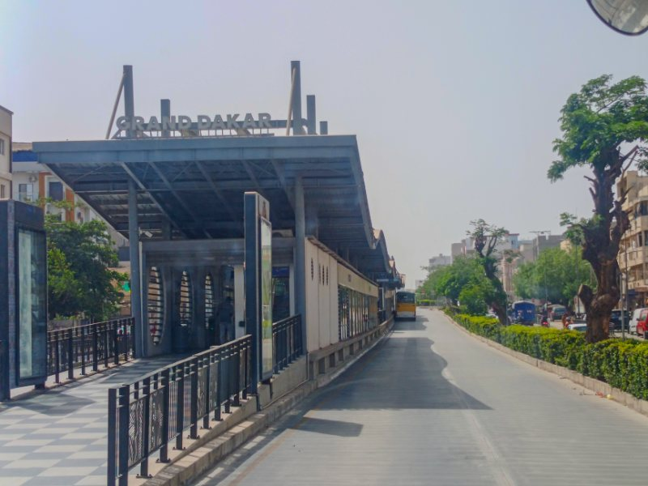
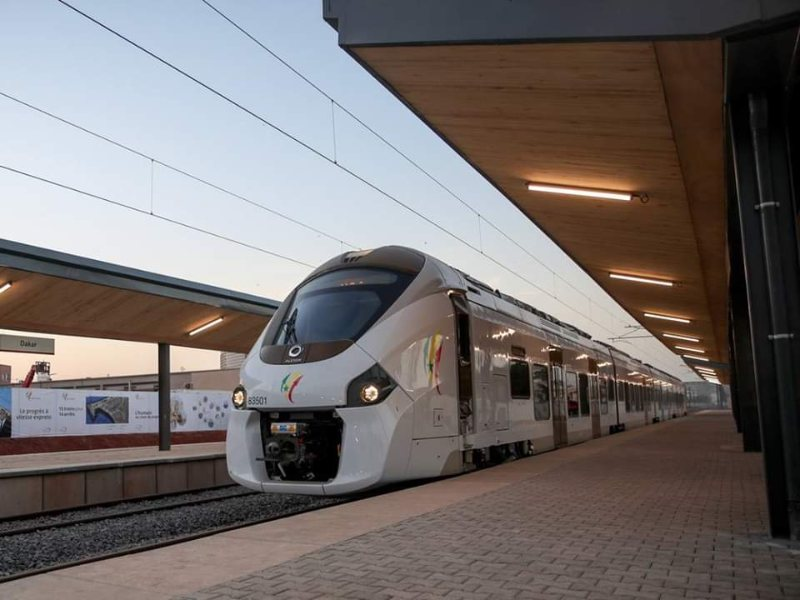
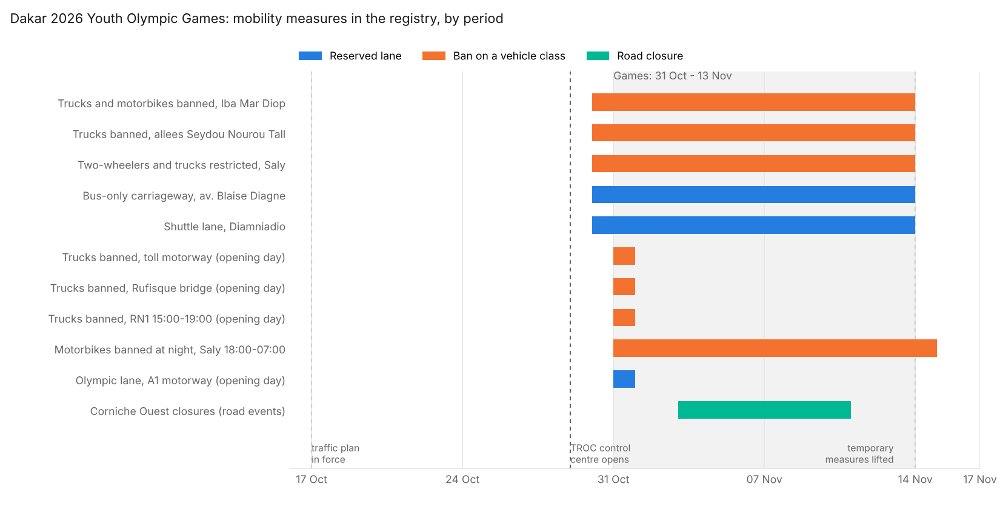
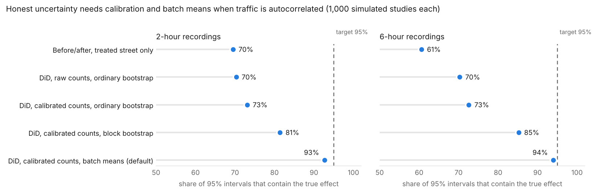
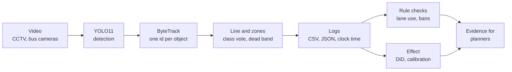

# Traffic Vision Senegal

[](https://github.com/princiliadaci/traffic-vision-senegal/actions/workflows/tests.yml)

**Did the Dakar 2026 mobility measures change traffic? Measuring it from
video, with honest uncertainty and without identifying anyone.**

For the Youth Olympic Games (31 October to 13 November 2026), Dakar applied
166 traffic-calming measures: a bus-only carriageway on avenue Blaise Diagne,
an Olympic lane on the motorway, trucks banned by the hour, motorbikes banned
at night in Saly, the Corniche Ouest closed for road races. Around the Games,
technology was everywhere: a transport control centre, bus geolocation,
State video surveillance, drones, an AI assistant, AI moderation of abuse
against athletes. Yet none of the public sources I found describes a system
that measured whether the **rules themselves** worked, and the official guide
says the most useful arrangements were meant to stay after the Games.

Traffic Vision turns video that already exists into that evidence: who used a
reserved lane, how many banned vehicles still passed, where traffic went when
a road closed, and whether the change is larger than what the city saw
everywhere else.

<table>
<tr>
<td width="25%"></td>
<td width="25%"></td>
<td width="25%"></td>
<td width="25%"></td>
</tr>
<tr>
<td><sub>A reserved lane: the BRT at Grand Dakar, May 2026. <i>4MAPS, CC BY 4.0</i></sub></td>
<td><sub>Car rapide, motorbike, taxis and a bus in HLM: the mix a Dakar model must learn. <i>Lisa Coulaud, CC BY-SA 4.0</i></sub></td>
<td><sub>Mixed traffic, taxis and buses. <i>Ji-Elle, public domain</i></sub></td>
<td><sub>The TER, backbone of the Games transport plan. <i>S. A. Gueye (VOA), public domain</i></sub></td>
</tr>
</table>

## Research question

> Can existing video become credible, privacy-preserving evidence of the
> effect of temporary mobility measures in an African city, and how uncertain
> is that evidence once detector errors are taken into account?

The full research note, with related work and references, is in
[`docs/research.md`](docs/research.md). The verified context of the Games
(measures, dates, technology, sources) is in
[`docs/context_joj_dakar_2026.md`](docs/context_joj_dakar_2026.md).

## What this project adds

1. **A registry of the Games measures** ([`configs/joj_measures.yaml`](configs/joj_measures.yaml)):
   eleven verified measures, each with its place, dates, hours, the indicator a
   camera can produce, what the camera cannot see, and its sources.
2. **Rule checks from video**: lane use by class in a polygon zone, the rate of
   a banned class inside and outside the ban hours, and a
   difference-in-differences for closures.
3. **An error-aware estimate of the effect**: counts corrected by a few minutes
   of manual counting, and confidence intervals that stay honest when traffic
   is autocorrelated. A simulation study shows why both are needed.
4. **Counting fixes found on real footage**: a dead band around the counting
   line and a class vote per track, after tracing errors frame by frame.
5. **Privacy by design**: anonymous tracks and classes only, no plates, no
   faces. It measures the use of the road, not offenders.



## First results

**What a camera can see.** Of the eleven measures, two are fully observable on
video, eight partly and one not with current models. The blind spots are
permits (accredited vehicles, residents' stickers) and legal categories (the
3.5 tonne limit for trucks). Video measures the use of the road, not
compliance, and results should be reported that way.

**What goes wrong in practice.** On a 57-second test clip, every counted event
was checked by eye. Cars waiting on the line at a red light were counted in
both directions (fixed with a dead band), a police van was labelled "bus" at
the moment it crossed (fixed with a class vote over the whole track), and
two buses queuing behind a lamp post got new identities, which inflated the
lane count (not fixed yet: camera placement and manual calibration matter).

**How much to trust an estimated effect.** In 1,000 simulated studies of a
closure (true effect known, detector finding 82% of vehicles, traffic
autocorrelated, two hours of video per period):

| Estimator | Mean estimate (truth 12) | 95% interval contains the truth |
|---|---|---|
| Before/after on the treated street only | 14.8 | 70% |
| Difference-in-differences, raw counts | 10.1 | 70% |
| ... with counts corrected by a manual sample | 12.0 | 73% |
| ... and a block bootstrap | 12.0 | 81% |
| ... and batch means with a t value (default) | 12.0 | 93% |



A before/after comparison mistakes the city-wide change for the effect; raw
counts shrink the effect by the detector's miss rate; ordinary intervals are
too narrow. Honest intervals are wide: with two hours per period, a 20% effect
is detected in only 27% of simulated studies, so **several days of recording
per period** are needed. Details: [`docs/results/simulation.md`](docs/results/simulation.md).

## Why it matters beyond the Games

- **Road data is thin.** ANASER, the national road-safety agency, recorded 868
  deaths and 15,407 crashes in 2025, while the World Health Organization
  estimates more than 3,500 road deaths a year in Senegal.
- **Two-wheelers are central.** They account for 38% of road crashes
  according to ANASER, and generic models and manual surveys handle them
  poorly.
- **Big investments deserve measurement.** The electric BRT runs 18.3 km from
  Guédiawaye to Petersen; the TER reached the airport in September 2026. Each
  deserves a before-and-after measurement, and so do the next large events.

## The pipeline



- **Detection**: cars, buses, trucks, motorbikes, bicycles and pedestrians.
  Labels from any model (COCO, BDD100K, VisDrone or a model fine-tuned on Dakar
  images) are mapped to these six classes by name. A person sitting on a
  motorbike is a rider, not a pedestrian, so *jakarta* traffic does not
  inflate pedestrian counts.
- **Tracking**: ByteTrack keeps one identity per object; the class of a track
  is the one with the highest summed confidence.
- **Counting**: once per object when its contact point with the road crosses a
  line (with a dead band), or uses a zone such as a reserved lane.
- **Analysis**: flows, passenger car equivalents, shares, exposure of
  vulnerable users, rule checks, and the effect of a measure.

Method and data schema: [`docs/methodology.md`](docs/methodology.md).

## Quick start

```bash
git clone https://github.com/princiliadaci/traffic-vision-senegal.git
cd traffic-vision-senegal
python -m venv .venv && source .venv/bin/activate
pip install -e ".[dashboard,dev]"

# count a junction, with a zone on a reserved lane and the clock time of the first frame
traffic-vision run --video data/blaise_diagne.mp4 --scene blaise_diagne \
    --line 0.05,0.7 0.95,0.7 --directions northbound southbound \
    --zone bus_carriageway 0.10,0.45 0.48,0.45 0.50,0.95 0.05,0.95 \
    --start-clock 2026-11-04T07:00:00

traffic-vision measures                                    # the Games measures
traffic-vision check blaise_diagne_bus_carriageway outputs/blaise_diagne
traffic-vision calibrate manual_counts.csv outputs/blaise_diagne
traffic-vision did --treated-before outputs/cheikh_anta_diop_before \
    --treated-during outputs/cheikh_anta_diop_closure \
    --control-before outputs/control_street_before \
    --control-during outputs/control_street_closure --calibration manual_counts.csv

streamlit run app/dashboard.py                             # upload, watch, explore, check
python scripts/simulate_evaluation.py                      # reproduce the simulation
```

The first run downloads the `yolo11n.pt` weights. Scenes can be described in
YAML ([`configs/scenes.example.yaml`](configs/scenes.example.yaml)), which
holds the study design for the Games. A [`Dockerfile`](Dockerfile) packages
the dashboard and the command line.

## Demo

Test clip: Pexels video 12159587, a London junction filmed from a fixed point
(not Dakar), 57 seconds, one frame out of two analysed at about 5 frames per
second on a CPU. The amber zone is an illustration on the kerb lane, not a
real bus lane.


- The line counted 45 vehicles: 39 cars, 2 buses and 4 trucks or vans, about
  47 per minute (51 before the counting fixes).
- The zone was used by 27 vehicles; the 7 "buses" include duplicates from the
  identity switches described above. `traffic-vision check` prints the lane
  report ([`examples/demo/lane_check.txt`](examples/demo/lane_check.txt)).
- First half against second half of the clip: -0.17 vehicles per 5 s, 95%
  interval [-2.50, +2.33]. The interval includes 0, as it should for the same
  traffic.

These counts have not been checked against a full manual count yet. Outputs:
[`examples/demo`](examples/demo).

## Roadmap

- [x] Detection, tracking, counting and export, end to end
- [x] Zones for reserved lanes, clock time for rules with hours
- [x] Registry of the Games measures and rule checks
- [x] Difference-in-differences with calibration and honest intervals, validated by simulation
- [x] Dashboard, Docker package, tests
- [ ] Footage from the Games period (CETUD, Dakar Dem Dikk) or new recordings at the same points
- [ ] Local dataset: Dakar frames with *car rapide*, *Ndiaga Ndiaye*, tricycles, horse carts, night and rain; fine-tuning with [`scripts/train_yolo.py`](scripts/train_yolo.py)
- [ ] Merge duplicate tracks in queues; speed in km/h from a calibrated view

## Project structure

```
traffic_vision/
  taxonomy.py     model labels -> six road-user classes
  counting.py     line crossing with direction and dead band
  zones.py        polygon zones (reserved lanes), counted once per object
  pipeline.py     YOLO11 + ByteTrack, rider filter, class vote, logs, annotated video
  rules.py        measure registry, lane use, bans by the hour, Poisson intervals
  evaluation.py   calibration, difference-in-differences, batch means, block bootstrap
  analysis.py     flows, PCE, shares, exposure, aggregation, period comparison
  report.py       charts and report.md
  cli.py          run | report | compare | aggregate | measures | check | did | calibrate
app/dashboard.py              Streamlit interface
configs/joj_measures.yaml     the Games measures, with sources
configs/scenes.example.yaml   study design for the Games
scripts/                      simulation, timeline figure, fine-tuning
docs/  tests/  examples/demo/
```

## Limits and privacy

No Dakar footage has been analysed yet: the demo shows the mechanics. Accuracy
drops with occlusion, night video and vehicle types absent from training
data, and a difference-in-differences is only as good as its control site.
The tool keeps anonymous tracks and classes; it does not read faces or number
plates. Filming public space in Senegal falls under Law no. 2008-12 on
personal data, overseen by the CDP.

## En bref (français)

Pendant les JOJ Dakar 2026, 166 mesures de circulation ont été appliquées :
voie réservée aux bus sur l'avenue Blaise Diagne, voie olympique, camions
interdits à certaines heures, motos interdites la nuit à Saly, fermetures de
la Corniche Ouest. Beaucoup de technologies ont été déployées, mais aucune
source publique ne décrit un dispositif qui mesure si ces règles ont changé le
trafic.

Traffic Vision le mesure à partir de vidéos existantes, sans identifier
personne. Le projet comprend :

- un registre de onze mesures vérifiées, avec ce qu'une caméra peut mesurer ;
- des tests par règle ;
- une estimation de l'effet en différence de différences, corrigée par un
  court comptage manuel.

Une simulation montre qu'une comparaison avant/après se trompe et qu'il faut
plusieurs jours d'enregistrement par période pour conclure.

## Sources

- Games measures and technology: [`docs/context_joj_dakar_2026.md`](docs/context_joj_dakar_2026.md)
- ANASER figures for 2025, reported by Le Soleil: https://lesoleil.sn/actualites/societe-fait-divers/datajournalisme-868-morts-15-407-accidents-le-bilan-glacant-des-routes-senegalaises-en-2025/ ; WHO estimate cited by iRAP: https://irap.org/fr/?p=5299 ; two-wheelers and 38% of crashes, ANASER via APS/AllAfrica: https://fr.allafrica.com/stories/202509230483.html
- Dakar BRT: World Bank, https://www.worldbank.org/en/news/feature/2022/11/28/with-bus-rapid-transit-african-cities-are-riding-toward-a-better-future ; TER airport section: https://senego.com/ter-la-desserte-de-laibd-officiellement-mise-en-service_2007129.html
- Research references: [`docs/research.md`](docs/research.md#references)
- Photos (Wikimedia Commons): [Arrêt BRT grand Dakar 01](https://commons.wikimedia.org/wiki/File:Arr%C3%AAt_BRT_grand_Dakar_01.jpg) by 4MAPS, [CC BY 4.0](https://creativecommons.org/licenses/by/4.0); [Car rapide à Dakar (quartier HLM)](https://commons.wikimedia.org/wiki/File:Car_rapide_%C3%A0_Dakar_(quartier_HLM).jpg) by Lisa Coulaud, [CC BY-SA 4.0](https://creativecommons.org/licenses/by-sa/4.0); [TrafficJamDakar](https://commons.wikimedia.org/wiki/File:TrafficJamDakar.jpg) by Ji-Elle, public domain; [Le TER à la gare de Dakar](https://commons.wikimedia.org/wiki/File:Le_TER_%C3%A0_la_gare_de_Dakar,_le_15_janvier_2019.jpg) by Seydina Aba Gueye (VOA), public domain. Images cropped and resized; see [`docs/img/CREDITS.md`](docs/img/CREDITS.md).

## Author

**Princilia DACI**, African Institute for Mathematical Sciences (AIMS) Senegal.
[LinkedIn](https://www.linkedin.com/in/princiliadaci/) ·
[GitHub](https://github.com/princiliadaci)

To cite this work, see [`CITATION.cff`](CITATION.cff).

## License

Code under MIT, see [LICENSE](LICENSE). Photos keep their own licenses (see
Sources). Detection and tracking use
[Ultralytics](https://github.com/ultralytics/ultralytics), distributed under
AGPL-3.0: check its terms before shipping a product built on it. The demo clip
comes from [Pexels](https://www.pexels.com) and is not included in the
repository.
