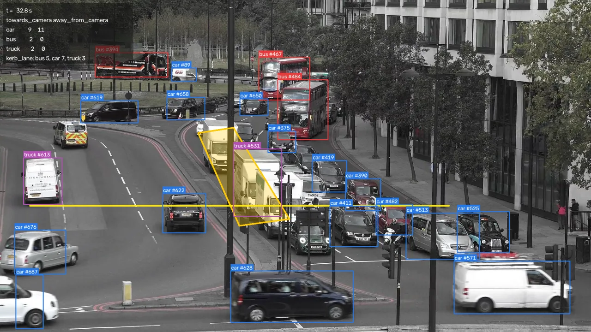
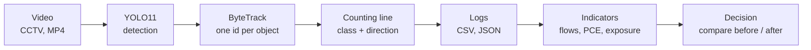
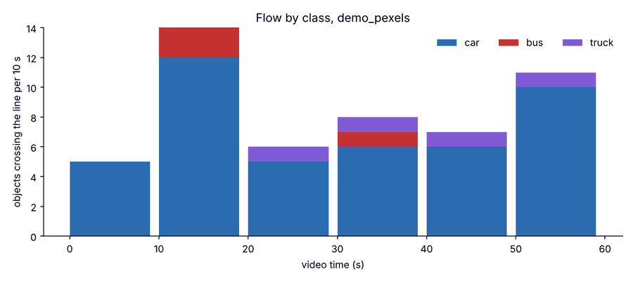

# Traffic Vision Senegal

**Counting road users from video to support mobility planning in Senegal.**

On the morning of 7 November 2026, during the Dakar Youth Olympic Games, the
Corniche Ouest was closed to cars and two lanes of avenue Blaise Diagne were
kept for accredited buses. Where did the cars go? Did the buses actually use
their lanes? Answering with numbers is hard, because traffic planning in Dakar
still leans on occasional manual counts.

Yet cameras already watch the city: on junctions, on buses, along the TER.
Traffic Vision turns that footage into counts: how many cars, buses, trucks,
motorbikes, bicycles and pedestrians pass a point, in which direction, hour
by hour, and whether that changed after a decision. Video in, structured counts
out, with no new sensor to buy.



*Demo on a static-camera stock clip (Pexels, London, not Senegal): each object
keeps an id from frame to frame and is counted once when it crosses the yellow line.*

## Why it matters

- **Road data is thin.** ANASER, the national
  road-safety agency, recorded 868 deaths and 15,407 crashes in 2025, while
  the World Health Organization estimates more than 3,500 road deaths a year
  in Senegal: the gap itself shows how thin the counts are.
- **Two-wheelers are central.** They account for 38% of road crashes according
  to ANASER, yet generic traffic models and manual surveys handle them poorly.
- **The country is investing.** The electric BRT runs 18.3 km from Guédiawaye
  to Petersen with 121 buses and promised to halve the trip from 90 to 45
  minutes; the TER reached the airport in September 2026. Each investment
  deserves a before-and-after measurement.

## The pipeline



1. **Detection**: cars, buses, trucks, motorbikes, bicycles and pedestrians, in
   every frame. Labels from any model (COCO, BDD100K, VisDrone or a model
   fine-tuned on Dakar images) are mapped to these six classes by name.
2. **Tracking**: ByteTrack keeps one identity per object, also through short
   occlusions in dense traffic.
3. **Counting**: an object is counted once, when its contact point with the road
   crosses a line drawn across the lanes, with its direction.
4. **Analysis**: flow per interval, passenger car equivalents, vehicle shares,
   exposure of vulnerable users, multi-camera aggregation, and a before/after
   comparison with a bootstrap confidence interval.

Two details matter for Senegalese streets:

- **Motorbike riders are not pedestrians.** Generic models detect the rider and
  the motorbike separately; a person whose feet sit inside a two-wheeler box is
  treated as a rider, so pedestrian counts are not inflated by *jakarta* traffic.
- **Traffic signs and lights are not road users.** They are left out of every
  count, so totals describe people and vehicles only.

## Quick start

```bash
git clone https://github.com/princiliadaci/traffic-vision-senegal.git
cd traffic-vision-senegal
python -m venv .venv && source .venv/bin/activate
pip install -e ".[dashboard,dev]"

# count objects crossing a line at 60% of the frame height
traffic-vision run --video data/my_junction.mp4 --scene my_junction \
    --line 0.05,0.6 0.95,0.6 --directions towards_camera away_from_camera

traffic-vision report outputs/my_junction        # charts and report.md
traffic-vision compare outputs/site_before outputs/site_during --interval 300
traffic-vision aggregate                          # merge all runs into one dataset

streamlit run app/dashboard.py                    # upload, watch live, explore, compare
```

The first run downloads the `yolo11n.pt` weights. Scenes can be described in
YAML ([`configs/scenes.example.yaml`](configs/scenes.example.yaml)). A
[`Dockerfile`](Dockerfile) packages the dashboard and the command line.

Each run writes `annotated.mp4`, `detections.csv` (one row per object per
frame, with box, track id and speed in pixels per second), `crossings.csv`
(one row per counted crossing), `summary.json` and `report.md`. The schema is
described in [`docs/methodology.md`](docs/methodology.md#6-data-schema).

## Applications for Senegal

| Use | What the counts give |
|---|---|
| BRT and TER feeder planning | cars, minibuses and motorbikes around stations, and how demand moves after each phase opens |
| Congestion management | flow by class, hour and direction for signal timing and detours, instead of one-off surveys |
| Road safety exposure | pedestrians and motorbikes per hour, the denominator that risk rates need |
| CCTV reuse | existing cameras become counting stations; only a computer is added |
| Motorways and big events | toll sections, the Grand Magal of Touba, the Dakar 2026 Youth Olympic Games |
| Open data for planners | one CSV/JSON schema to compare sites and periods |

### Case study: the Dakar 2026 Youth Olympic Games

For the Games (31 October to 13 November 2026) the authorities announced
166 traffic-calming measures, an Olympic lane on the motorway, bus-only lanes
on avenue Blaise Diagne, closures on the Corniche Ouest, restrictions on
trucks near Diamniadio, and shuttle buses between Dakar, Diamniadio and Saly.
[`docs/context_joj_dakar_2026.md`](docs/context_joj_dakar_2026.md) summarises
this plan with its sources and turns it into measurable questions: did the
bus lanes carry buses, where did Corniche traffic go during closures, did the
truck ban hold, and which changes lasted after the Games.
`traffic-vision compare` answers them from two recordings of the same place.

## Demo result

On a 57-second clip of a London junction (Pexels video 12159587, static camera,
one frame out of two analysed, at about 5 frames per second on a CPU),
the line counted 51 vehicles: 44 cars, 3 buses and 4 trucks or vans, about
54 vehicles per minute.



As a check of the comparison method, the first half of the clip against the
second half gives +0.43 vehicles per 5 s with a 95% interval of [-2.07, +2.93]:
the interval includes 0, as it should for two samples of the same traffic.
Full outputs are in [`examples/demo`](examples/demo).

These counts have not yet been checked against a manual count. Before using
the tool in a study, count a sample by hand and report the error per class
([methodology, section 7](docs/methodology.md#7-validating-counts)).

## Roadmap

- [x] Detection, tracking, counting and export, end to end
- [x] ByteTrack for dense scenes and occlusions
- [x] Counting line set by the user (command line, YAML or dashboard)
- [x] Multi-camera aggregation into one dataset
- [x] Period comparison with confidence intervals
- [x] Docker package
- [ ] Local dataset: film and annotate Dakar junctions, with local classes
      (*car rapide*, *Ndiaga Ndiaye*, tricycles, horse carts), night and rain
- [ ] Fine-tune a larger model (YOLO11s or m, 50 to 100 epochs, class weights
      for motorbikes) with [`scripts/train_yolo.py`](scripts/train_yolo.py)
- [ ] Counting zones (polygons) and speed in km/h from a calibrated view
- [ ] GPU image for real-time use on municipal servers

## Project structure

```
traffic_vision/
  taxonomy.py    model labels -> six road-user classes
  counting.py    line crossing with direction, counted once per object
  pipeline.py    YOLO11 + ByteTrack over a video, rider filter, logs, annotated video
  analysis.py    flows, PCE, shares, exposure, aggregation, period comparison
  report.py      charts and report.md
  cli.py         traffic-vision run | report | compare | aggregate
app/dashboard.py       Streamlit interface
scripts/train_yolo.py  fine-tuning on BDD100K, VisDrone or local images
configs/  docs/  tests/  examples/demo/
```

## Limits and privacy

Accuracy drops with occlusion, night video and vehicle types absent from the
training data; a comparison is only fair between recordings of the same place
at comparable times. The tool counts anonymous tracks: it does not identify
faces or number plates. Filming public space in Senegal falls under Law
no. 2008-12 on personal data, overseen by the CDP.

## En bref (français)

Traffic Vision compte les usagers de la route à partir de vidéos existantes
(voitures, bus, camions, motos, vélos, piétons), avec leur sens de circulation,
puis produit des indicateurs pour la planification : flux par heure, part des
transports en commun, exposition des piétons et des motos, comparaison avant et
après une mesure. Le cas d'étude porte sur le dispositif de mobilité des JOJ
Dakar 2026.

## Sources for the figures above

- ANASER figures for 2025, reported by Le Soleil (August 2026): https://lesoleil.sn/actualites/societe-fait-divers/datajournalisme-868-morts-15-407-accidents-le-bilan-glacant-des-routes-senegalaises-en-2025/
- WHO estimate cited by iRAP: https://irap.org/fr/?p=5299
- Two-wheelers and 38% of crashes, ANASER via APS/AllAfrica (September 2025): https://fr.allafrica.com/stories/202509230483.html
- Dakar BRT: World Bank, https://www.banquemondiale.org/fr/news/feature/2022/11/28/with-bus-rapid-transit-african-cities-are-riding-toward-a-better-future ; Systra, https://www.systra.com/en/news/100-electric-buses-for-dakar/
- Games mobility plan: see [`docs/context_joj_dakar_2026.md`](docs/context_joj_dakar_2026.md)

## Author

**Princilia DACI**, African Institute for Mathematical Sciences (AIMS) Senegal.
[LinkedIn](https://www.linkedin.com/in/princiliadaci/) ·
[GitHub](https://github.com/princiliadaci)

## License

MIT, see [LICENSE](LICENSE). Detection and tracking use
[Ultralytics](https://github.com/ultralytics/ultralytics), distributed under
AGPL-3.0: check its terms before shipping a product built on it. The demo clip
comes from [Pexels](https://www.pexels.com) and is not included in the repository.
