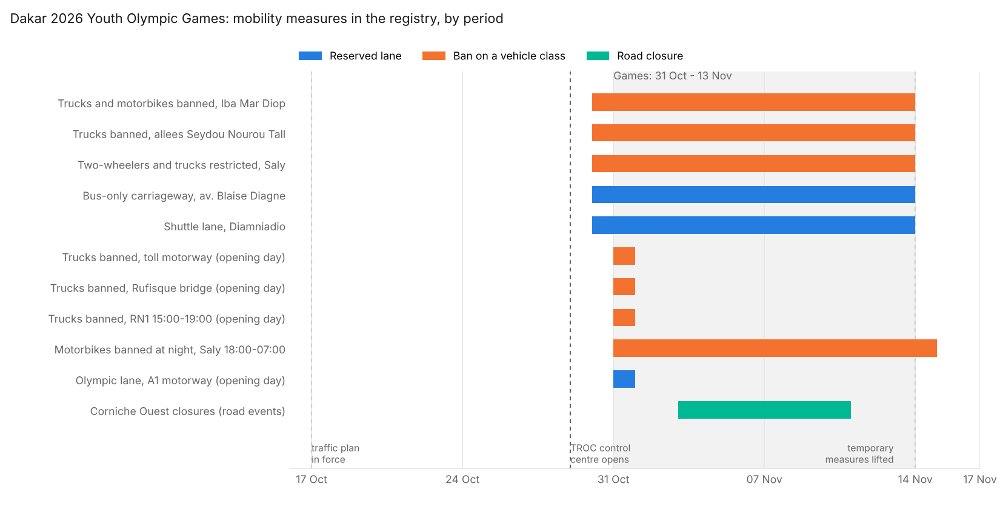

# Context: moving people during the Dakar 2026 Youth Olympic Games

The Youth Olympic Games (Jeux Olympiques de la Jeunesse, JOJ) Dakar 2026 took
place from 31 October to 13 November 2026. It was the first Olympic event held
in Africa, with about 2,700 athletes across three hubs: Dakar, Diamniadio and
Saly. Moving athletes, officials and spectators between these hubs without
stopping the city was one of the main operational challenges. The governor of
Dakar summed up the principle as letting the Games run without stopping Dakar
from running.

This page gathers the public information on the mobility plan and on the
technology used around it, then explains where this repository fits. Every
figure comes from the sources listed at the end; check the official documents
before reusing them. The measures are also stored, one by one, in
[`configs/joj_measures.yaml`](../configs/joj_measures.yaml).

## Who organised mobility

- The Ministry of Land and Air Transport set up a **Mobility Committee for
  Dakar JOJ 2026**. Its secretariat was run by **CETUD** (Conseil exécutif des
  transports urbains durables), Dakar's urban transport authority.
- **Dakar Dem Dikk** (DDD), the national bus company, was the official ground
  transport partner of the organising committee (COJOJ). Its director general
  announced 184 buses for the Games shuttles.
- Close to 15,000 members of the defence and security forces were engaged for
  the Games, according to the head of the Games transport and traffic
  commission.

## Calendar

| Date | Step |
|---|---|
| 6 October 2026 | Traffic plan presented by the governor of Dakar: 166 traffic-calming measures, 14 junctions classed as critical or high risk |
| 17 October | Plan in force around the sites; CETUD Mobilités services available |
| 20-21 October | Governor's order on the Autoroute de l'Avenir for the opening ceremony (20 October); prefectoral order no. 393 of 21 October framing the plan around the sites |
| 29 October | Transport Operations Center (TROC) installed by CETUD |
| 30 October | Regulation devices in place |
| 31 October | Opening ceremony at the Abdoulaye Wade stadium, Diamniadio |
| 1-12 November | Maximum deployment, daily coordination |
| 13 November | Closing |
| 14 November | Temporary measures removed |

## The measures

The guide states four principles: separate flows (pedestrians, accredited
vehicles, Games buses, general traffic), protect users (lower speeds, clear
walkways, emergency access), give priority to public transport, and return to
normal with *"la volonté de pérenniser après les Jeux les aménagements les plus
utiles"*: the most useful arrangements were meant to stay after the Games.

| Place | Measure |
|---|---|
| Autoroute de l'Avenir, opening day | Left lane of the Patte-d'Oie to AIBD section reserved for Olympic traffic: towards Diamniadio from 7:00 to 19:00, the other way from 19:00 to 23:30. Exit 11 kept for accredited vehicles. |
| Heavy vehicles, opening day | Vehicles over 3.5 t banned, except authorised local deliveries: toll motorway Patte-d'Oie to Sébikhotane 7:00 to 23:30 (both directions), Rufisque to Keur Ndiaye Lô bridge 7:00 to 19:00, RN1 Rufisque to Sébikhotane 15:00 to 19:00 |
| Iba Mar Diop complex, Médina | Carriageways of avenue Blaise Diagne beside the stadium reserved for accredited Games buses, opposite lanes open to all; rue 11 for Games buses and emergencies; trucks over 3.5 t and two-wheelers banned around the site; residents need a COJOJ sticker |
| Tour de l'Œuf and Point E | Area pedestrianised, accredited vehicles only; heavy vehicles banned on the allées Seydou Nourou Tall |
| Corniche Ouest | Closures from 3 November with varying hours; closed both ways 6:00 to 16:00 on 7, 8 and 10 November, and from 9 November 15:00 to 10 November 16:00 for road cycling; diversions via avenue Cheikh Anta Diop, rue Aimé Césaire and the Fann Résidence axes. One newspaper counted about 74 hours of closure in a week. |
| Diamniadio | General traffic banned inside security perimeters; right lane of the Sphères ministérielles axis for shuttles and accredited vehicles; 2,214 spectator parking spaces away from the sites |
| Saly | Served by Games lines only; motorbikes, tricycles, trucks and carts restricted; by an order of 30 October, motorbikes banned from 18:00 to 7:00 in Saly Portudal, Ngaparou and Somone until 14 November |
| Public transport | TER (a train every 8 minutes between Dakar and Diamniadio; airport section open since 28 September 2026), BRT, Dakar Dem Dikk, AFTU minibuses; Games shuttles from 8 departure points to 12 destinations, 6:30 to 22:00 |

The authorities described the restrictions as temporary, controlled and
reversible.

## Technology and AI around the Games

A lot of technology was deployed. What it was used for matters for this
project:

| System | What it did | Source |
|---|---|---|
| TROC, Transport Operations Center | Real-time monitoring of traffic and transport, coordination of operators, police and gendarmerie, in liaison with the COJOJ Main Operations Centre | Mobility guide; Le Soleil; SenePlus |
| Dakar Dem Dikk control centre (opened 6 July 2026) | Bus geolocation, on-board video, real-time incident reports and statistics | APS / AllAfrica; Seneweb |
| CETUD Mobilités app | All operators in one app, taxi booking, real-time alerts | Mobility guide |
| State video surveillance | Declared compliant with the law by the CDP, the data protection authority | Osiris |
| Drones | Ten drones and six anti-drone systems for the gendarmerie; four drones and thermal cameras for the TER | Seneweb; APS / AllAfrica |
| Alibaba Cloud | Private cloud for core Games services, an AI assistant answering questions in English and French; the Games cloud infrastructure is to be handed to the Senegalese government | IOC; Alibaba Cloud |
| IOC Cyber Abuse Protection Service | AI scanning social media in 56 languages for abuse aimed at the 2,700 athletes, with human review of every flag | IOC |
| Olympic Broadcasting Services | AI for automated highlights, audio mixing and content discovery | IOC |

These systems served security, broadcasting, athlete protection and
information. None of the sources describes a system that **measured whether
the reserved lanes, closures and bans changed traffic**. At the time of
writing (late November 2026) I found no published traffic figures for the
Games period. The national context points the same way: the New Deal
technologique, launched in February 2025, makes AI and a sovereign cloud
priorities, and the road-safety plan announced automated enforcement
(vidéoverbalisation). Enforcement identifies offenders; evaluation measures
the effect of a policy. This repository does the second.

## Where computer vision helps

Most measures change **how many vehicles, of which type, use a given piece of
road**. The registry turns each one into a question a camera can answer, and
says what the camera cannot see:

1. **Did the reserved carriageway of avenue Blaise Diagne carry buses?** Share
   of buses among vehicles in the lane (`traffic-vision check
   blaise_diagne_bus_carriageway`). A camera cannot tell an accredited bus from
   a regular one.
2. **Where did Corniche traffic go during the closures?** Flows on the
   diversion routes against a control street, closure day against a normal
   day, with a difference-in-differences (`traffic-vision did`).
3. **Did the night ban on motorbikes in Saly hold?** Motorbikes per hour after
   18:00 against before (`traffic-vision check saly_night_motorbike_ban`).
4. **Which changes lasted?** The guide intended to keep the most useful
   arrangements. Filming the same points after 14 November shows what stayed.

Two of the eleven measures in the registry are fully observable on video, eight
partly, one not at all with current models. The blind spots are permits
(accreditation, resident stickers) and legal categories (the 3.5 t limit for
trucks). Video measures **use of the road**, not compliance.

## Limits and privacy

- **Comparable recordings**: same place, same weekday, same time of day, and a
  control site for anything that changed city-wide during the Games.
- **Detection errors**: occlusions, night video and vehicle types absent from
  training data (cars rapides, Ndiaga Ndiaye, tricycles, horse carts) lower
  accuracy. Count a sample by hand and correct the counts (`traffic-vision
  calibrate`).
- **Privacy**: the tool counts classes and anonymous track numbers. It does not
  read faces or number plates and keeps no image unless asked for the annotated
  video. Filming public space falls under Law no. 2008-12 on personal data and
  the CDP; reuse of real footage should keep to aggregate data, limited
  retention and a stated purpose.

## Sources

Mobility plan and measures
- Ministry of Land and Air Transport and CETUD, *Guide de la mobilité Dakar JOJ 2026* (1 October 2026): https://www.vie-publique.sn/documents/14568/guide-mobilite-dakar-joj-2026
- Le Soleil, plan presented on 6 October, in force on 17 October: https://lesoleil.sn/actualites/sports/joj-dakar-2026-un-plan-de-circulation-deploye-a-partir-du-17-octobre/
- SenePlus, the governor's 166 measures: https://www.seneplus.com/article/joj-2026-dakar-prevoit-166-mesures-pour-reguler-la-circulation
- Le Soleil, Olympic lane and truck restrictions for the opening ceremony: https://lesoleil.sn/joj-dakar-2026/joj-dakar-2026-une-voie-olympique-et-des-restrictions-sur-lautoroute-de-lavenir-pour-la-ceremonie-douverture/
- Afrik.com, Corniche Ouest closures and order no. 393: https://www.afrik.com/joj-dakar-2026-vingt-cinq-heures-sans-voitures-sur-la-corniche-ouest-en-pleine-semaine
- Seneweb, CETUD plan for the Corniche Ouest: https://seneweb.com/en/news/Transport/joj-dakar-2026-le-cetud-devoile-le-plan-de-circulation-sur-la-corniche-ouest_n_999002564.html
- Senego, Corniche diversions for road cycling: https://senego.com/joj-dakar-2026-pour-le-cyclisme-les-deviations-de-la-corniche-ouest-a-suivre_2021893.html
- Dakaractu, night ban on motorbikes in Saly, Ngaparou and Somone: https://www.dakaractu.com/PETITE-COTE-Les-motos-interdites-de-circulation-la-nuit-a-Saly-Ngaparou-et-Somone_a277643.html
- Seneweb, heavy vehicles, public transport and about 15,000 security personnel: https://www.seneweb.com/fr/news/Transport/joj-dakar-2026-mobilite-ce-qui-change-pour-la-circulation-les-poids-lourds-et-les-transports-collectifs_n_999002079.html
- Au Sénégal, shuttles and the 184 Dakar Dem Dikk buses: https://www.au-senegal.com/joj-dakar-2026-comment-se-deplacer-pendant-les-jeux,18563.html
- Senego, TER airport section and 8-minute frequency: https://senego.com/ter-la-desserte-de-laibd-officiellement-mise-en-service_2007129.html

Technology
- Le Soleil, installation of the TROC: https://lesoleil.sn/joj-dakar-2026/joj-dakar-2026-un-centre-de-controle-installe-pour-une-vision-consolidee-du-trafic-routier/
- SenePlus, the TROC and the actors it coordinates: https://www.seneplus.com/article/joj-dakar-2026-et-fluidite-des-deplacements-le-ministre-des-transports-mise-sur
- APS / AllAfrica, Dakar Dem Dikk control centre: https://fr.allafrica.com/stories/202607080245.html
- Osiris, CDP on the Games video surveillance: https://www.osiris.sn/joj-le-dispositif-de-videosurveillance-mis-en-place-par-l-etat-est-conforme-a.html
- Seneweb, gendarmerie resources: https://www.seneweb.com/en/news/S%C3%A9curit%C3%A9/youth-olympic-games-security-the-overall-plan-unveiled_n_999001974.html
- APS / AllAfrica, TER drones and thermal cameras: https://fr.allafrica.com/stories/202609020593.html
- IOC, how the Worldwide Olympic Partners helped deliver Dakar 2026: https://www.olympics.com/ioc/news/how-the-worldwide-olympic-partners-helped-deliver-dakar-2026
- IOC, Cyber Abuse Protection Service at Dakar 2026: https://www.olympics.com/ioc/news/ioc-cyber-abuse-protection-service-to-make-youth-olympic-games-debut-as-part-of-dakar-2026-athlete-support-package
- IOC, OBS coverage and AI at Dakar 2026: https://www.olympics.com/ioc/news/obs-expands-coverage-and-introduces-new-production-initiatives-at-dakar-2026
- Alibaba Cloud announcement (7 August 2025): https://www.alibabacloud.com/blog/602440
- Osiris, New Deal technologique, cloud and AI in the general policy statement (8 September 2026): https://www.osiris.sn/dpg-cloud-souverain-ia-le-gouvernement-veut-passer-des-annonces-a-l-execution.html
- APS / AllAfrica, road-safety measures including automated enforcement (February 2026): https://fr.allafrica.com/stories/202602040519.html
