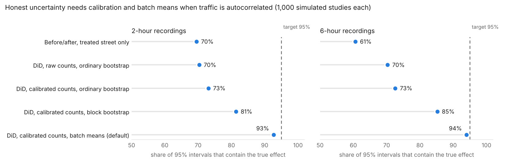

# Did the Games measures change traffic? Measuring mobility policies from video in Dakar

*Research note, Princilia DACI, AIMS Senegal. Working draft, November 2026.*

## 1. The question

For the Dakar 2026 Youth Olympic Games (31 October to 13 November 2026), the
authorities applied 166 traffic-calming measures: a bus-only carriageway on
avenue Blaise Diagne, an Olympic lane on the motorway, truck bans by the hour,
a night ban on motorbikes in Saly, closures of the Corniche Ouest, shuttle
lanes in Diamniadio. The mobility guide also says the most useful arrangements
were meant to stay after the Games.

A lot of technology surrounded the event: a transport control centre (the
TROC), a bus control centre with geolocation and on-board cameras, State video
surveillance, drones, a cloud with an AI assistant, AI moderation of abuse
against athletes, AI-edited highlights. None of the public sources I found
describes a system that measured **whether the traffic rules did what they
were meant to do**, and two weeks after the Games I found no published traffic
figures for the period. Yet that is the evidence needed to decide which
measures to keep.

This project asks:

> Can video that already exists be turned into credible, privacy-preserving
> evidence of the effect of temporary mobility measures in an African city,
> and how uncertain is that evidence once the errors of the detector are
> taken into account?

Three sub-questions follow.

- **Q1. Observability.** Which of the Games measures can a camera observe at
  all, and what does it miss?
- **Q2. From rule to indicator.** How does each kind of rule (reserved lane,
  ban on a class of vehicle, closure) become a number computed from video?
- **Q3. Honest uncertainty.** How much do detection errors and the
  autocorrelation of traffic distort an estimated effect, and how can the
  estimate and its interval be corrected?

## 2. Related work

**Detection, tracking and counting.** One-stage detectors in the YOLO family
(Redmon et al., 2016; Jocher and Qiu, 2024) and trackers such as ByteTrack
(Zhang et al., 2022) make vehicle counting from fixed cameras routine. The AI
City Challenge ran a multi-class, multi-movement vehicle counting track
(Naphade et al., 2020, 2021), and studies compare YOLO counts with manual
counts (Majumder and Wilmot, 2023). This literature reports how accurate the
counts are; it does not ask what an error in counts does to a policy
conclusion.

**Data beyond Europe and North America.** BDD100K (Yu et al., 2020), VisDrone
(Zhu et al., 2021) and the India Driving Dataset (Varma et al., 2019) widen
the range of scenes, the last one for unstructured, mixed traffic close to
Dakar's. In Africa, recent work builds local datasets: tricycle-aware ("keke")
counting in Nigeria with a public video dataset and a field evaluation
(Akujobi et al., 2026), an 11-class road-object dataset with edge deployment
(Muzata et al., 2026). Other African systems aim at enforcement, for example
plate recognition and SMS tickets in Kampala (Mugizi et al., 2026).

**Evaluating transport measures and mega-events.** The Atlanta 1996 Olympic
transport strategy came with a 23% drop in peak morning traffic and is a
classic natural experiment (Friedman et al., 2001); Beijing 2008 has been
evaluated for air quality (Chen et al., 2013) and Beijing's driving
restrictions for pollution and labour supply, with compliance checked on
parking records (Viard and Fu, 2015). These studies rely on loop detectors,
administrative records or monitoring stations. The difference-in-differences
design (Card and Krueger, 1994) is the standard tool, and serial correlation
is a known trap: ordinary standard errors understate uncertainty (Bertrand,
Duflo and Mullainathan, 2004).

**The gap.** I found no work that starts from a city's actual traffic rules,
asks which of them video can observe, and carries detector error and
autocorrelation into the uncertainty of the estimated effect. That is the
contribution of this project, in the setting of the first Olympic event held
in Africa.

## 3. What this project adds

1. **A registry of the Games measures with their observability**
   ([`configs/joj_measures.yaml`](../configs/joj_measures.yaml)). Eleven
   measures, each with its place, dates, hours, rule type, the video
   indicator it implies, what a camera cannot see, and its sources.
2. **Rule checks from video**: use of a reserved lane by class (polygon
   zones), the rate of a banned class during the ban hours against outside
   them (with clock time and Poisson intervals), and a difference-in-differences
   for closures. `traffic-vision check <measure> <run>` runs the right test.
3. **An error-aware estimator.** Automatic counts are corrected with a short
   manual count (ratio of totals per class), and the interval accounts for
   both the correction and autocorrelated traffic (batch means with a Student
   t value). A simulation study shows why each piece is needed.
4. **Counting fixes found on real footage**: a dead band around the counting
   line and a per-track class vote, both motivated by errors I traced frame
   by frame (section 5.2).
5. **Privacy by design.** The tool keeps classes and anonymous track numbers,
   never plates or faces. It measures the use of the road, not offenders, which
   separates it from enforcement systems such as video ticketing.

## 4. Method in short

- **Detection and tracking**: YOLO11 and ByteTrack through Ultralytics; model
  labels mapped by name to six road-user classes; riders on two-wheelers not
  counted as pedestrians.
- **Counting**: crossings of a line by the contact point of each box, with a
  dead band of 1% of the frame height; uses of a zone after two frames inside;
  the class of a track is the class with the highest summed confidence.
- **Rules**: see [`traffic_vision/rules.py`](../traffic_vision/rules.py).
- **Effect**: difference-in-differences on flows per interval between a
  treated and a control site, before and during a measure, on counts
  corrected by a manual calibration; interval from batch means (default four
  batches per recording) or a moving block bootstrap
  ([`traffic_vision/evaluation.py`](../traffic_vision/evaluation.py)).

Details and the data schema are in [`methodology.md`](methodology.md).

## 5. Results so far

### 5.1 What a camera can and cannot see (Q1)

Of the eleven measures in the registry, **two are fully observable** on video
(the Corniche closures through their effect on diversion routes, and the night
motorbike ban in Saly), **eight partly**, and **one not with current models**
(tricycles and horse carts in Saly are not classes of models trained on COCO).
The blind spots are of two kinds:

- **permits**: accredited vehicles and residents' stickers (four measures).
  A car in a bus lane may be allowed;
- **legal categories**: the 3.5 tonne limit for trucks (five measures). The
  "truck" class of COCO also covers vans and pickups.

So video measures the **use** of the road, not compliance with the rule. That
distinction shapes how results should be reported to the authorities.

### 5.2 Error analysis on a real clip

The pipeline was run on a 57-second stock clip (Pexels 12159587, a London
junction filmed from a fixed point; not Dakar). Inspecting every counted event
frame by frame showed three kinds of error:

| Error | What happened | Fix | Effect on this clip |
|---|---|---|---|
| Jitter at a red light | Cars queuing on the line had boxes moving by a few pixels, counted once in each direction | dead band of 1% of the frame height | 6 crossings removed (51 to 45): 5 from jitter, 1 car creeping in the queue whose track was then lost |
| Class flicker | A police van labelled "bus" and an SUV labelled "truck" at the frame where they crossed | class with the highest summed confidence over the track | both corrected; final count 45: 39 cars, 2 buses, 4 trucks or vans |
| Identity switches | Two buses queuing nose to tail behind a lamp post got new track numbers | not fixed yet | in the lane zone, 7 "buses" for about 4 real ones; two vehicles still counted both ways on the line |

The last row is the important one for reserved lanes: occlusion by street
furniture inflates zone counts of large vehicles. Two lessons for fieldwork in
Dakar: place counting lines away from stop lines and queues, and choose camera
positions with no pole in front of the lane. Remaining errors are exactly what
the manual calibration is for.

### 5.3 Simulation study (Q3)

[`scripts/simulate_evaluation.py`](../scripts/simulate_evaluation.py)
simulates 1,000 studies of a closure: a diversion route and a control street,
filmed before and during, counted per 5 minutes. The truth is known: traffic
rises by 6 vehicles per 5 minutes everywhere during the Games, the measure adds
12 on the diversion route, the detector finds 82% of vehicles and adds one
false detection per interval, and eight intervals are counted by hand.

With autocorrelated traffic and two-hour recordings:

| Estimator | Mean estimate (truth 12) | 95% interval contains the truth |
|---|---|---|
| Before/after on the treated street only | 14.8 | 70% |
| Difference-in-differences, raw counts | 10.1 | 70% |
| ... with counts corrected by the manual sample | 12.0 | 73% |
| ... and a moving block bootstrap | 12.0 | 81% |
| ... and batch means with a t value (default) | 12.0 | 93% |

With six-hour recordings, the default reaches 94% coverage (95% with
independent intervals). Three conclusions:

- a before/after comparison mistakes the city-wide change for the effect of
  the measure;
- raw counts understate the effect by about the detector's miss rate; a few
  minutes of manual counting remove that bias;
- with autocorrelated traffic, ordinary and block bootstrap intervals are too
  narrow. Honest intervals are wide: with two hours per period, a 20% effect
  is detected in only 27% of simulated studies, and in 49% with six hours.
  **Several days of recording per period, not a few hours, are needed.** That
  is a concrete recommendation for whoever films the next event.

Full tables: [`docs/results/simulation.md`](results/simulation.md).

## 6. Limits

- No Dakar footage has been analysed yet. The demo clip shows the mechanics,
  not Senegalese traffic.
- The difference-in-differences assumes that the treated and control sites
  would have changed alike without the measure. The choice of the control site
  carries the result.
- The simulation uses one plausible traffic model (Poisson counts with a
  persistent log-normal fluctuation). Real traffic can be more irregular.
- Models trained on COCO miss cars rapides, Ndiaga Ndiaye, tricycles and
  carts as distinct classes, and night video lowers accuracy.
- Video cannot see permits or weights: results describe use, not offences.

## 7. Next steps

1. **Footage.** Ask CETUD (TROC) and Dakar Dem Dikk (control centre, on-board
   cameras) for short extracts from the Games period at a few points, under
   the conditions of Law 2008-12 and the CDP. Recordings are usually kept for
   a limited time, so the request is urgent. Otherwise, film the same points
   now (after the Games) and during the next large event.
2. **Sites.** Avenue Cheikh Anta Diop (Corniche diversion) against a control
   street; the Blaise Diagne carriageway; a Saly entrance after 18:00.
3. **Local data.** Annotate about 2,000 Dakar frames with local classes and
   fine-tune ([`scripts/train_yolo.py`](../scripts/train_yolo.py)).
4. **Validation.** Ten one-minute manual counts per site, used both to report
   the error per class and to correct the counts.
5. **Identity switches.** Merge duplicate tracks that overlap strongly, and
   test a re-identification tracker on queues.

## References

- Akujobi, M. U. et al. (2026). Keke-aware vehicle counting for traffic measurement using YOLO: dataset and field evaluation. *Applied Sciences*, 16(9), 4316. https://www.mdpi.com/2076-3417/16/9/4316
- Bertrand, M., Duflo, E. and Mullainathan, S. (2004). How much should we trust differences-in-differences estimates? *Quarterly Journal of Economics*, 119(1), 249-275.
- Card, D. and Krueger, A. B. (1994). Minimum wages and employment: a case study of the fast-food industry in New Jersey and Pennsylvania. *American Economic Review*, 84(4), 772-793.
- Chen, Y., Jin, G. Z., Kumar, N. and Shi, G. (2013). The promise of Beijing: evaluating the impact of the 2008 Olympic Games on air quality. *Journal of Environmental Economics and Management*, 66(3), 424-443.
- Friedman, M. S., Powell, K. E., Hutwagner, L., Graham, L. M. and Teague, W. G. (2001). Impact of changes in transportation and commuting behaviors during the 1996 Summer Olympic Games in Atlanta on air quality and childhood asthma. *JAMA*, 285(7), 897-905. https://pubmed.ncbi.nlm.nih.gov/11180733/
- Jocher, G. and Qiu, J. (2024). Ultralytics YOLO11 (software). https://github.com/ultralytics/ultralytics
- Künsch, H. R. (1989). The jackknife and the bootstrap for general stationary observations. *Annals of Statistics*, 17(3), 1217-1241.
- Majumder, M. and Wilmot, C. (2023). Automated vehicle counting from pre-recorded video using You Only Look Once (YOLO) object detection model. *Journal of Imaging*, 9(7), 131. https://doi.org/10.3390/jimaging9070131
- Mugizi, B., Murindanyi, S., Nakacwa, O. and Katumba, A. (2026). Intelligent traffic surveillance for real-time vehicle detection, license plate recognition, and speed estimation. arXiv:2601.00344.
- Muzata, R., Nkundineza, C. and Kimotho, J. K. (2026). Region-specific road object detection in African environments: dataset curation, benchmarking, and edge deployment. *Engineering, Technology and Applied Science Research*, 16(2), 34423-34430. https://doi.org/10.48084/etasr.17251
- Naphade, M. et al. (2020). The 4th AI City Challenge. *CVPR Workshops*. https://arxiv.org/abs/2004.14619
- Naphade, M. et al. (2021). The 5th AI City Challenge. *CVPR Workshops*. https://arxiv.org/abs/2104.12233
- Redmon, J., Divvala, S., Girshick, R. and Farhadi, A. (2016). You only look once: unified, real-time object detection. *CVPR*.
- Varma, G., Subramanian, A., Namboodiri, A., Chandraker, M. and Jawahar, C. V. (2019). IDD: a dataset for exploring problems of autonomous navigation in unconstrained environments. *WACV*.
- Viard, V. B. and Fu, S. (2015). The effect of Beijing's driving restrictions on pollution and economic activity. *Journal of Public Economics*, 125, 98-115. https://doi.org/10.1016/j.jpubeco.2015.02.003
- Yu, F. et al. (2020). BDD100K: a diverse driving dataset for heterogeneous multitask learning. *CVPR*.
- Zhang, Y. et al. (2022). ByteTrack: multi-object tracking by associating every detection box. *ECCV*.
- Zhu, P. et al. (2021). Detection and tracking meet drones challenge. *IEEE TPAMI*.

Sources on the Games measures and technology: [`context_joj_dakar_2026.md`](context_joj_dakar_2026.md).

## Résumé en français

Pendant les JOJ Dakar 2026, 166 mesures de circulation ont été appliquées
(voie réservée aux bus sur l'avenue Blaise Diagne, voie olympique, camions
interdits à certaines heures, motos interdites la nuit à Saly, fermetures de la
Corniche Ouest). Beaucoup de technologies ont été déployées, mais aucune source
publique ne décrit un dispositif qui mesure si ces règles ont réellement changé
le trafic. Ce projet propose de le faire à partir de vidéos existantes, sans
identifier personne.

Les apports :

1. un registre de onze mesures vérifiées, avec ce qu'une caméra peut mesurer
   et ce qu'elle ne voit pas (autorisations, poids des camions) ;
2. des tests par type de règle ;
3. une estimation de l'effet en différence de différences, corrigée par un
   court comptage manuel, avec des intervalles honnêtes quand le trafic est
   autocorrélé ;
4. des corrections du comptage trouvées en analysant de vraies images.

La simulation montre qu'une simple comparaison avant/après se trompe, que les
comptages bruts sous-estiment l'effet, et qu'il faut plusieurs jours
d'enregistrement par période pour conclure.
