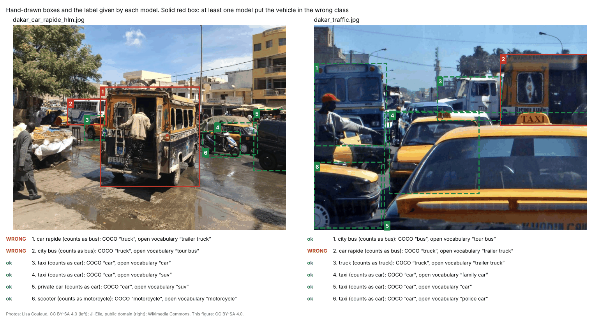
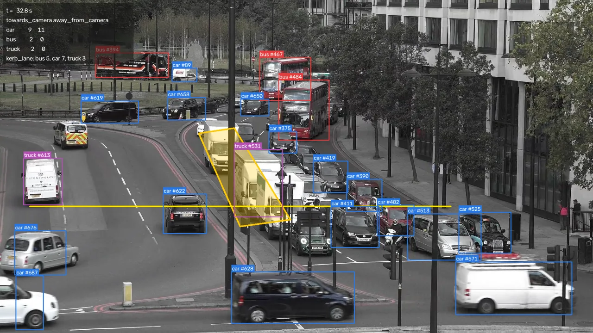
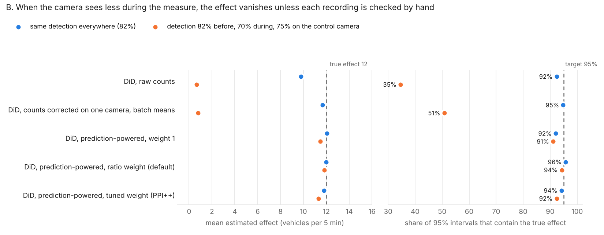
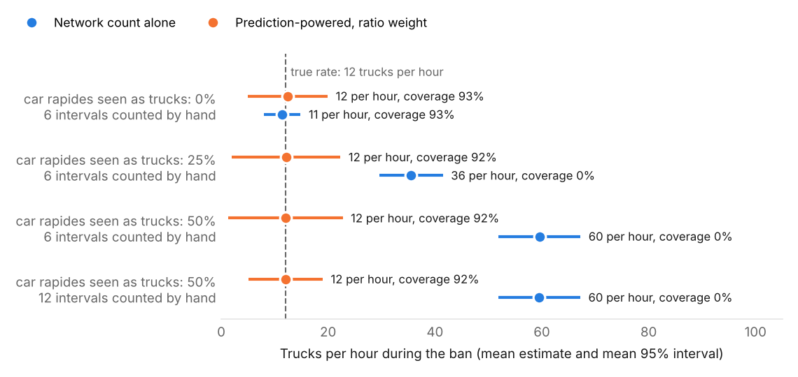

# Did the rule work? Measuring urban mobility policies from video, with honest uncertainty

*Research note, Princilia DACI, AIMS Senegal. Working draft, November 2026.*

Worked example: the mobility plan of the Dakar 2026 Youth Olympic Games (JOJ).
Other examples in the repository: the Dakar BRT corridor, the okada ban in
Lagos and the car-free days of Kigali.

## 1. The question

African cities change their traffic rules all the time, and for different
reasons:

- **events**: for the Dakar 2026 Youth Olympic Games (31 October to 13
  November 2026), the authorities applied 166 traffic measures, among them a
  bus-only carriageway on avenue Blaise Diagne, an Olympic lane on the
  motorway, truck bans by the hour and closures of the Corniche Ouest;
- **infrastructure**: the Dakar BRT opened in 2024 with a dedicated corridor,
  a truck ban from 6:00 to 21:00 in its zone of influence and a ban on carts;
- **regulation**: Lagos banned commercial motorcycles (okada) from the
  highways of six local government areas on 1 June 2022;
- **recurring closures**: Kigali has closed major roads to motor vehicles on
  Sunday mornings since 2016.

How are these rules evaluated? For Kigali, with air-quality monitors (PM2.5
about 15% lower on car-free days, Kalisa et al., 2021). For Lagos, with
surveys of residents (Ackrill and Olusanya, 2023) and statements by the
police. For the Games, a lot of technology was deployed (a transport control
centre, geolocated buses with on-board cameras, State video surveillance, an
AI assistant), but none of the public sources I found describes a system that
measured whether the traffic rules did what they were meant to do, and as of
27 November 2026 I found no published traffic figures for the period. Traffic
counts, the most direct evidence, are missing in all four cases, while
cameras are already on the roads.

This project asks:

> Can existing video be turned into credible, privacy-preserving evidence of
> the effect of a mobility rule in an African city, for any city and any
> kind of rule, and how uncertain is that evidence once the errors of the
> neural network are carried through to the conclusion?

Four sub-questions follow.

- **Q1. Observability.** Which rules can a camera observe at all, and what
  does it miss?
- **Q2. Perception.** Do pretrained detectors, closed or open vocabulary,
  see the local vehicles correctly, and which of their errors matter for a
  given rule?
- **Q3. Inference.** How can counts from an imperfect detector give a valid
  estimate of a rule's effect, when traffic is autocorrelated and the
  detector does not see equally well in every recording?
- **Q4. Design.** How many hours, days and hand counts does a study need?

## 2. Related work

**Detection, tracking and counting.** One-stage detectors in the YOLO family
(Redmon et al., 2016; Jocher and Qiu, 2024) and trackers such as ByteTrack
(Zhang et al., 2022) make vehicle counting from fixed cameras routine. The AI
City Challenge ran a multi-class, multi-movement counting track (Naphade et
al., 2020, 2021), and studies compare YOLO counts with manual counts
(Majumder and Wilmot, 2023). This literature reports how accurate the counts
are; it does not ask what an error in counts does to a policy conclusion.

**Open-vocabulary detection and geographic bias.** Open-vocabulary detectors
name objects outside a fixed list, from text prompts, visual prompts or a
large built-in vocabulary: YOLO-World (Cheng et al., 2024) and YOLOE (Wang et
al., 2025), which runs in real time and has a prompt-free mode. They look
like a shortcut for cities whose vehicles are absent from COCO. But object
recognition is known to work worse on objects from low-income countries
(DeVries et al., 2019), so whether these models name a car rapide correctly
is an empirical question.

**Data beyond Europe and North America.** BDD100K (Yu et al., 2020),
VisDrone (Zhu et al., 2021) and the India Driving Dataset (Varma et al., 2019)
widen the range of scenes. In Africa, recent work builds local datasets:
tricycle-aware ("keke") counting in Nigeria with a field evaluation (Akujobi
et al., 2026), an 11-class road-object dataset with edge deployment (Muzata
et al., 2026). Other systems aim at enforcement, for example plate
recognition in Kampala (Mugizi et al., 2026).

**Inference with machine-learning predictions.** Prediction-powered
inference (PPI) gives valid confidence intervals when many predictions are
combined with a few gold-standard labels (Angelopoulos et al., 2023); PPI++
tunes the weight given to predictions (Angelopoulos, Duchi and Zrnic, 2023),
and design-based supervised learning does the same for downstream regressions
(Egami et al., 2023). The ratio estimator of survey sampling (Cochran, 1977)
is the oldest member of this family. As far as I know these tools have not
been applied to traffic counts from video, where the labels are short manual
counts and the predictions are autocorrelated over time.

**Evaluating transport policies.** The Atlanta 1996 Olympic transport plan
came with a 23% drop in peak morning traffic (Friedman et al., 2001); Beijing
2008 was evaluated for air quality (Chen et al., 2013) and Beijing's driving
restrictions for pollution and activity (Viard and Fu, 2015). These studies
use loop detectors, administrative records or monitoring stations, which most
African cities do not have. The difference-in-differences design (Card and
Krueger, 1994) is the standard tool, and serial correlation is a known trap
(Bertrand, Duflo and Mullainathan, 2004).

**The gap.** I found no work that starts from a city's actual traffic rules,
asks which of them video can observe, tests whether current detectors see the
local vehicles that the rules target, and carries detector error and
autocorrelation into the interval of the estimated effect.

## 3. The framework

```
measure registry ──► which indicator, which test, what the camera cannot see
(rules of a city)          │
                           ▼
context profile ──► detector (COCO, fine-tuned or open vocabulary) + tracker
(local vehicles)           │  label mapping, counting line, zones, movements
                           ▼
                    counts per class and interval, per recording
                           │
a few hand counts ──►      ▼
per recording       prediction-powered difference-in-differences
                    (batch means for autocorrelation) ──► effect and 95% interval
```

1. **Measure registries** ([`measures/`](../measures)). A rule is described
   once, in YAML, with its place, dates, hours, recurrence, the classes it
   allows or bans, the indicator it implies, what a camera cannot see and
   its sources. Five kinds cover the cases met so far: reserved lane, ban on
   a class (on a line or inside a zone), banned movement between two lines,
   promised service frequency, closure. `traffic-vision check <measure>
   <run>` picks the test that fits the kind.
2. **Context profiles** ([`contexts/`](../contexts)). The local vehicle
   types (car rapide, Ndiaga Ndiaye, jakarta, charrette in Dakar; danfo,
   keke, okada in Lagos; moto-taxi in Kigali), the core class each one is
   counted in, the labels of open-vocabulary models that may catch it, and
   the data protection law that applies to filming. A new city is a new
   file, not new code.
3. **Perception.** Any Ultralytics detector: a COCO model, a model
   fine-tuned on local images, or an open-vocabulary model (YOLOE
   prompt-free), whose labels are mapped by name to eight core classes
   (pedestrian, bicycle, motorcycle, tricycle, car, bus, truck, cart). Three
   fixes found on real footage: a dead band around the counting line, a
   per-track class vote, and riders not counted as pedestrians. Several
   named lines give turning movements ("A>B").
4. **Inference.** A difference-in-differences between a treated and a
   control site, before and during the rule. Each recording gets its own
   prediction-powered estimate from a few hand-counted intervals, so a camera
   that sees worse than another, or a crowd that hides vehicles during the
   rule, does not bias the effect. The variance of the network's part uses
   batch means because traffic is autocorrelated
   ([`traffic_vision/evaluation.py`](../traffic_vision/evaluation.py)).
5. **Design.** `traffic-vision design` simulates the study before anyone
   films and tells how many hours and days are needed.
6. **Privacy by design.** Classes and anonymous track numbers only, never
   plates or faces. The tool measures the use of the road, not offenders.

How to apply it elsewhere: [`adapt_to_your_city.md`](adapt_to_your_city.md).

## 4. Results

### 4.1 What a camera can and cannot see (Q1)

Seventeen measures in four registries, three countries:

| Registry | Policy type | Measures | Fully observable | Partly | Not with current models |
|---|---|---|---|---|---|
| Dakar 2026 Youth Olympic Games | event | 11 | 2 | 8 | 1 |
| Dakar BRT corridor | infrastructure | 4 | 1 | 2 | 1 |
| Lagos okada ban | regulation | 1 | 0 | 1 | 0 |
| Kigali car-free days | recurring closure | 1 | 1 | 0 | 0 |
| **Total** | | **17** | **4** | **11** | **2** |

The blind spots come back in every city and are of three kinds:

- **permits and status**: accredited vehicles, residents' stickers,
  emergency vehicles, and whether a motorcycle is a commercial okada or a
  private one;
- **legal categories**: the 3.5 tonne limit for trucks; the COCO "truck"
  class also covers vans and pickups;
- **local vehicles absent from training data**: carts and tricycles in
  Dakar, and, as the next section shows, the car rapide.

So video measures the **use** of the road, not compliance with the rule.
That distinction shapes how results should be reported to the authorities.

### 4.2 Do detectors see Dakar's vehicles? (Q2)

[`scripts/probe_open_vocabulary.py`](../scripts/probe_open_vocabulary.py)
runs three detectors on four photos of Dakar and compares their labels with
hand-drawn boxes ([`results/open_vocabulary_probe.md`](results/open_vocabulary_probe.md)).
Four photos make a probe, not a benchmark: it shows the kind of error, not its
rate.

| Detector | Vehicles in the right class | Missed |
|---|---|---|
| COCO, closed vocabulary (YOLO11n) | 9 of 13 | 1 |
| Open vocabulary, no prompt (YOLOE-11S, 4,585 classes) | 11 of 13 | 0 |
| Open vocabulary, one-shot visual prompt (car rapide, city bus, taxi) | 0 of 5 on an unseen photo | 4 |

- **Both detectors call the car rapide a truck**, in both photos where it
  appears ("truck" for COCO, "trailer truck" for YOLOE). The car rapide is
  the most common minibus of Dakar.
- The open-vocabulary model fixes other errors: it sees the small BRT bus
  that COCO misses and calls a city bus a "tour bus" where COCO
  says "truck". Its fine-grained labels ("suv", "police car", "family car")
  all fall in the right core class once mapped.
- A one-shot visual prompt drawn on one photo does not transfer to another:
  it labelled the city bus "car rapide" and missed the rest.
- The TER train is labelled "train" by both and correctly ignored.



**Why this error matters more than accuracy figures suggest.** Mapping
"trailer truck" to "bus" would break the count of real trucks, so the error
cannot be fixed by renaming labels. And it falls exactly where a rule draws a
line: truck bans exist in the Games plan and in the BRT zone of influence,
where car rapides run. A detector that sees car rapides as trucks reports
offences that never happened. The error that matters is not the average
precision of the detector but the confusion between two classes that the rule
treats differently. Section 4.4 measures what it does to a conclusion and how
to correct it.

### 4.3 Error analysis on a real clip

The pipeline was run on a 57-second stock clip (Pexels 12159587, a London
junction filmed from a fixed point; not Dakar). Inspecting every counted event
frame by frame showed three kinds of error:

| Error | What happened | Fix | Effect on this clip |
|---|---|---|---|
| Jitter at a red light | Cars queuing on the line had boxes moving by a few pixels, counted once in each direction | dead band of 1% of the frame height | 6 crossings removed (51 to 45): 5 from jitter, 1 car creeping in the queue whose track was then lost |
| Class flicker | A police van labelled "bus" and an SUV labelled "truck" at the frame where they crossed | class with the highest summed confidence over the track | both corrected; final count 45: 39 cars, 2 buses, 4 trucks or vans |
| Identity switches | Two buses queuing nose to tail behind a lamp post got new track numbers | not fixed yet | in the lane zone, 7 "buses" for about 4 real ones; two vehicles still counted both ways on the line |

Occlusion by street furniture inflates zone counts of large vehicles. For
fieldwork: place counting lines away from stop lines and queues, and choose
camera positions with no pole in front of the lane.



### 4.4 From imperfect counts to a valid effect (Q3)

[`scripts/simulate_evaluation.py`](../scripts/simulate_evaluation.py)
simulates 1,000 studies per scenario where the truth is known: traffic with a
persistent log-normal fluctuation (AR(1), a jam lasts several intervals) and
Poisson counts, a detector that misses vehicles and adds false ones, and a
few intervals counted by hand. Full tables:
[`results/simulation.md`](results/simulation.md).

**A. Autocorrelated traffic.** A closure adds 12 vehicles per 5 minutes on a
diversion route while traffic rises by 6 everywhere; the detector finds 82%
of vehicles; 8 intervals are counted by hand on one recording. With two-hour
recordings:

| Estimator | Mean estimate (truth 12) | 95% interval contains the truth |
|---|---|---|
| Before/after on the treated street only | 14.8 | 68% |
| Difference-in-differences (DiD), raw counts | 9.8 | 91% |
| DiD, counts corrected by the hand counts, ordinary bootstrap | 11.7 | 71% |
| ... moving block bootstrap | 11.7 | 79% |
| ... batch means with a t value | 11.7 | 92% |

A before/after comparison mistakes the city-wide change for the effect; raw
counts understate the effect by the miss rate; with autocorrelated traffic,
bootstrap intervals are too narrow.

**B. Cameras that do not see alike.** Same closure, six-hour recordings, but
the detector finds 82% of vehicles on the treated camera before the measure,
70% during it (a crowd, a security perimeter) and 75% on the control camera:

| Estimator | Mean estimate (truth 12) | 95% interval contains the truth |
|---|---|---|
| DiD, raw counts | 0.7 | 35% |
| DiD, counts corrected on one camera | 0.8 | 51% |
| DiD, prediction-powered, 6 hand-counted intervals per recording | 11.8 | 94% |

The effect disappears unless each recording is corrected with its own hand
counts: 30 minutes of manual counting out of 6 hours per recording recover
it. Among the weights of the network's counts, the ratio weight (default)
kept nominal coverage; plain PPI (weight 1) reached 91%; the tuned weight of
PPI++ was unstable with six labels.



**C. A vehicle that looks like the banned class.** The error found in
section 4.2, in a simulation: a truck ban checked over four hours where 12
trucks per hour still pass among 96 car rapides, and the detector labels a
share of car rapides as trucks.

| Car rapides seen as trucks | Network count alone | Prediction-powered, 6 hand counts | Prediction-powered, 12 hand counts |
|---|---|---|---|
| 0% | 11.4 per hour (coverage 93%) | 12.4 (93%) | |
| 25% | 35.5 (0%) | 12.1 (92%) | |
| 50% | 59.6 (0%) | 12.0 (92%) | 12.0 (92%), interval a third narrower |

With half the car rapides seen as trucks, the network reports five times the
true number of trucks and its interval never contains the truth. Six
five-minute hand counts bring the estimate back to the truth; the price is a
wide interval (plus or minus 11 trucks per hour), which twelve hand counts
make about a third narrower.



### 4.5 How much to film (Q4)

Chance that the 95% interval excludes zero for a +20% effect on a street with
60 vehicles per 5 minutes (`traffic-vision design --base 60 --effect 0.2`):

| Days per period | 2 hours a day | 4 hours | 8 hours |
|---|---|---|---|
| 1 | 22% | 34% | 56% |
| 3 | 46% | 70% | 93% |
| 7 | 76% | 96% | 100% |

**Several days per period, not a few hours, are needed.** For a one-day
event the effect can only be detected if it is large, which is worth knowing
before asking anyone for footage.

## 5. What this adds

1. **A rule-first framework** that works across cities and policy types:
   seventeen sourced measures in four registries (event, infrastructure,
   regulation, recurring closure; Senegal, Nigeria, Rwanda), each mapped to
   an indicator, a test and the camera's blind spots.
2. **Evidence that the detector errors that matter are policy-specific
   confusions.** Closed and open-vocabulary detectors both call Dakar's car
   rapide a truck, which turns into false offences under a truck ban.
3. **Prediction-powered difference-in-differences for traffic video**, with
   batch means for autocorrelation and one correction per recording. In
   simulation it recovers effects that raw and singly calibrated counts lose
   (0.7 against 12) and removes the bias of a look-alike class.
4. **A design tool** that turns these results into a filming plan.
5. **Privacy by design**: no plates, no faces, counts of use rather than
   offenders.

## 6. Limits

- No Dakar video has been analysed yet. The demo clip shows the mechanics,
  not Senegalese traffic; the perception probe uses four photos.
- The difference-in-differences assumes that the treated and control sites
  would have changed alike without the rule. The choice of the control site
  carries the result.
- The hand-counted intervals must be chosen at random within each recording;
  chosen by convenience, they can bias the correction.
- The simulation uses one plausible traffic model. Real traffic can be more
  irregular, and the detector's errors can depend on traffic density.
- The open-vocabulary model runs at about 1.3 frames per second on a laptop
  CPU, against about 5 for YOLO11n: a GPU, or a fine-tuned small model, is
  needed for hours of video.
- Video cannot see permits, weights or the purpose of a trip.

## 7. Next steps

1. **Footage.** Ask CETUD and Dakar Dem Dikk for short extracts from the
   Games period and from the BRT corridor, under Law 2008-12 and the
   conditions of the CDP. Otherwise film the same points now and during the
   next large event.
2. **Local data.** Annotate about 2,000 Dakar frames with the local classes
   (car rapide, Ndiaga Ndiaye, tricycle, charrette) and fine-tune
   ([`scripts/train_yolo.py`](../scripts/train_yolo.py)); repeat the probe on
   the fine-tuned model and on a larger, random sample of frames.
3. **Validation.** Ten random one-minute manual counts per recording, used
   both to report errors by class and for the prediction-powered estimate.
4. **Identity switches.** Merge duplicate tracks that overlap strongly and
   test a re-identification tracker on queues.
5. **Other cities.** The Lagos and Kigali registries are ready; the work is
   to find footage and a local partner.

## References

- Ackrill, R. and Olusanya, O. (2023). Traffic jams are overwhelming Africa's biggest city: here's what could help. *The Conversation*. https://theconversation.com/traffic-jams-are-overwhelming-africas-biggest-city-heres-what-could-help-207374
- Akujobi, M. U. et al. (2026). Keke-aware vehicle counting for traffic measurement using YOLO: dataset and field evaluation. *Applied Sciences*, 16(9), 4316. https://www.mdpi.com/2076-3417/16/9/4316
- Angelopoulos, A. N., Bates, S., Fannjiang, C., Jordan, M. I. and Zrnic, T. (2023). Prediction-powered inference. *Science*, 382(6671), 669-674. https://doi.org/10.1126/science.adi6000
- Angelopoulos, A. N., Duchi, J. C. and Zrnic, T. (2023). PPI++: efficient prediction-powered inference. arXiv:2311.01453.
- Bertrand, M., Duflo, E. and Mullainathan, S. (2004). How much should we trust differences-in-differences estimates? *Quarterly Journal of Economics*, 119(1), 249-275.
- Card, D. and Krueger, A. B. (1994). Minimum wages and employment: a case study of the fast-food industry in New Jersey and Pennsylvania. *American Economic Review*, 84(4), 772-793.
- Chen, Y., Jin, G. Z., Kumar, N. and Shi, G. (2013). The promise of Beijing: evaluating the impact of the 2008 Olympic Games on air quality. *Journal of Environmental Economics and Management*, 66(3), 424-443.
- Cheng, T., Song, L., Ge, Y., Liu, W., Wang, X. and Shan, Y. (2024). YOLO-World: real-time open-vocabulary object detection. *CVPR*, 16901-16911.
- Cochran, W. G. (1977). *Sampling Techniques*, 3rd edition. Wiley.
- DeVries, T., Misra, I., Wang, C. and van der Maaten, L. (2019). Does object recognition work for everyone? *CVPR Workshops*, 52-59.
- Egami, N., Hinck, M., Stewart, B. M. and Wei, H. (2023). Using imperfect surrogates for downstream inference: design-based supervised learning for social science applications of large language models. *NeurIPS*.
- Friedman, M. S., Powell, K. E., Hutwagner, L., Graham, L. M. and Teague, W. G. (2001). Impact of changes in transportation and commuting behaviors during the 1996 Summer Olympic Games in Atlanta on air quality and childhood asthma. *JAMA*, 285(7), 897-905. https://pubmed.ncbi.nlm.nih.gov/11180733/
- Jocher, G. and Qiu, J. (2024). Ultralytics YOLO11 (software). https://github.com/ultralytics/ultralytics
- Kalisa, E., Sudmant, A., Ruberambuga, R. and Bower, J. (2021). From car-free days to pollution-free cities: reflections on clean urban transport in Rwanda. International Growth Centre, policy paper RWA-20285. https://www.theigc.org/publications/car-free-days-pollution-free-cities-reflections-clean-urban-transport-rwanda
- Künsch, H. R. (1989). The jackknife and the bootstrap for general stationary observations. *Annals of Statistics*, 17(3), 1217-1241.
- Majumder, M. and Wilmot, C. (2023). Automated vehicle counting from pre-recorded video using You Only Look Once (YOLO) object detection model. *Journal of Imaging*, 9(7), 131. https://doi.org/10.3390/jimaging9070131
- Mugizi, B., Murindanyi, S., Nakacwa, O. and Katumba, A. (2026). Intelligent traffic surveillance for real-time vehicle detection, license plate recognition, and speed estimation. arXiv:2601.00344.
- Muzata, R., Nkundineza, C. and Kimotho, J. K. (2026). Region-specific road object detection in African environments: dataset curation, benchmarking, and edge deployment. *Engineering, Technology and Applied Science Research*, 16(2), 34423-34430. https://doi.org/10.48084/etasr.17251
- Naphade, M. et al. (2020). The 4th AI City Challenge. *CVPR Workshops*. https://arxiv.org/abs/2004.14619
- Naphade, M. et al. (2021). The 5th AI City Challenge. *CVPR Workshops*. https://arxiv.org/abs/2104.12233
- Redmon, J., Divvala, S., Girshick, R. and Farhadi, A. (2016). You only look once: unified, real-time object detection. *CVPR*.
- Varma, G., Subramanian, A., Namboodiri, A., Chandraker, M. and Jawahar, C. V. (2019). IDD: a dataset for exploring problems of autonomous navigation in unconstrained environments. *WACV*.
- Viard, V. B. and Fu, S. (2015). The effect of Beijing's driving restrictions on pollution and economic activity. *Journal of Public Economics*, 125, 98-115. https://doi.org/10.1016/j.jpubeco.2015.02.003
- Wang, A., Liu, L., Chen, H., Lin, Z., Han, J. and Ding, G. (2025). YOLOE: real-time seeing anything. *ICCV*, 24591-24602. arXiv:2503.07465.
- Yu, F. et al. (2020). BDD100K: a diverse driving dataset for heterogeneous multitask learning. *CVPR*.
- Zhang, Y. et al. (2022). ByteTrack: multi-object tracking by associating every detection box. *ECCV*.
- Zhu, P. et al. (2021). Detection and tracking meet drones challenge. *IEEE TPAMI*.

Sources on each measure are listed in its registry ([`measures/`](../measures)). Sources on the Games measures and technology: [`context_joj_dakar_2026.md`](context_joj_dakar_2026.md).

## Résumé en français

Les villes africaines changent souvent leurs règles de circulation : plan
temporaire pour un événement (JOJ Dakar 2026), infrastructure (corridor du
BRT de Dakar), réglementation (interdiction des okadas à Lagos), fermetures
récurrentes (journées sans voiture de Kigali). Leur évaluation repose sur la
qualité de l'air, des enquêtes ou des déclarations, rarement sur des
comptages, alors que les caméras sont déjà là. Ce projet propose une méthode
générale pour mesurer l'effet d'une règle à partir de vidéos, sans identifier
personne, avec les JOJ comme exemple détaillé.

Les apports :

1. des registres de dix-sept mesures sourcées dans trois pays, chacune
   associée à un indicateur, un test et ce que la caméra ne voit pas
   (autorisations, poids, véhicules locaux) ;
2. un test des détecteurs sur des photos de Dakar : le modèle COCO et le
   modèle à vocabulaire ouvert classent tous les deux le car rapide comme un
   camion, ce qui créerait de fausses infractions sous une interdiction des
   camions ;
3. une différence de différences « prediction-powered » : quelques minutes
   de comptage manuel dans chaque enregistrement corrigent les erreurs du
   réseau, même quand les caméras ne voient pas de la même façon ;
4. un outil qui dit combien d'heures et de jours filmer avant de commencer.

En simulation, quand la détection baisse pendant la mesure, l'effet disparaît
avec les comptages bruts (0,7 au lieu de 12) et réapparaît avec la correction
par enregistrement (11,8, intervalle à 94 %). Il faut plusieurs jours
d'enregistrement par période pour conclure.
