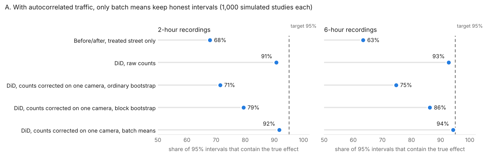
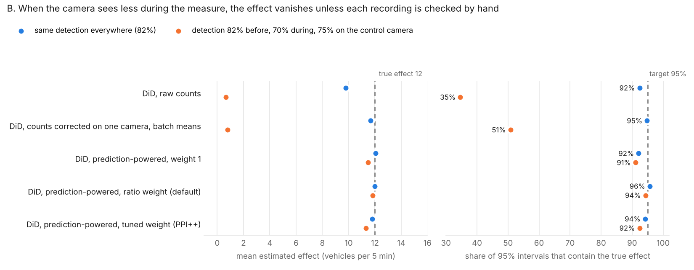
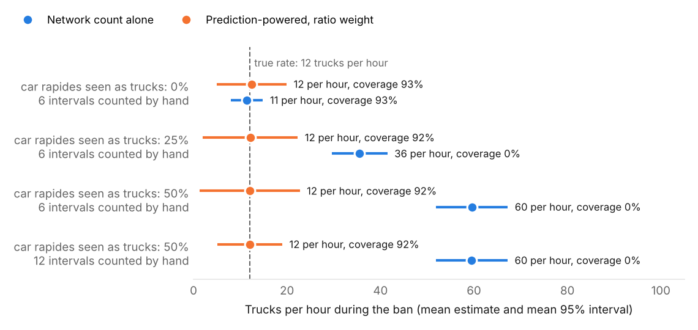

# Simulation study: results

1000 simulated studies per scenario. True effect +12 vehicles per 5 min, city-wide change +6, one false detection per interval. Produced by `scripts/simulate_evaluation.py`.

## A. Honest intervals with autocorrelated traffic

Detection 82% everywhere; 8 intervals counted by hand on one recording.

### 2-hour recordings, autocorrelated traffic (rho = 0.6)

| estimator | mean estimate (truth 12) | bias | RMSE | 95% CI coverage | mean CI width | CI excludes 0 |
|---|---|---|---|---|---|---|
| Before/after, treated street only | 14.8 | +2.8 | 6.9 | 67.9% | 13.8 | 90% |
| DiD, raw counts | 9.8 | -2.2 | 8.5 | 90.7% | 31.1 | 25% |
| DiD, counts corrected on one camera, ordinary bootstrap | 11.7 | -0.3 | 9.9 | 71.4% | 21.5 | 55% |
| DiD, counts corrected on one camera, block bootstrap | 11.7 | -0.3 | 9.9 | 79.4% | 25.8 | 46% |
| DiD, counts corrected on one camera, batch means | 11.7 | -0.3 | 9.9 | 91.7% | 37.3 | 25% |

### 6-hour recordings, autocorrelated traffic (rho = 0.6)

| estimator | mean estimate (truth 12) | bias | RMSE | 95% CI coverage | mean CI width | CI excludes 0 |
|---|---|---|---|---|---|---|
| Before/after, treated street only | 14.6 | +2.6 | 4.6 | 63.4% | 8.4 | 100% |
| DiD, raw counts | 9.7 | -2.3 | 5.3 | 92.8% | 20.5 | 45% |
| DiD, counts corrected on one camera, ordinary bootstrap | 11.6 | -0.4 | 5.7 | 74.7% | 12.9 | 82% |
| DiD, counts corrected on one camera, block bootstrap | 11.6 | -0.4 | 5.7 | 86.3% | 17.0 | 71% |
| DiD, counts corrected on one camera, batch means | 11.6 | -0.4 | 5.7 | 94.3% | 24.5 | 45% |

### 2-hour recordings, independent intervals (rho = 0)

| estimator | mean estimate (truth 12) | bias | RMSE | 95% CI coverage | mean CI width | CI excludes 0 |
|---|---|---|---|---|---|---|
| Before/after, treated street only | 14.8 | +2.8 | 4.4 | 82.5% | 12.5 | 99% |
| DiD, raw counts | 9.9 | -2.1 | 4.7 | 94.1% | 19.3 | 52% |
| DiD, counts corrected on one camera, ordinary bootstrap | 11.9 | -0.1 | 5.1 | 94.0% | 19.5 | 67% |
| DiD, counts corrected on one camera, block bootstrap | 11.9 | -0.1 | 5.1 | 91.9% | 18.6 | 69% |
| DiD, counts corrected on one camera, batch means | 11.9 | -0.1 | 5.1 | 95.6% | 23.2 | 52% |

### 6-hour recordings, independent intervals (rho = 0)

| estimator | mean estimate (truth 12) | bias | RMSE | 95% CI coverage | mean CI width | CI excludes 0 |
|---|---|---|---|---|---|---|
| Before/after, treated street only | 14.8 | +2.8 | 3.3 | 68.6% | 7.4 | 100% |
| DiD, raw counts | 9.9 | -2.1 | 3.2 | 88.8% | 11.0 | 95% |
| DiD, counts corrected on one camera, ordinary bootstrap | 11.8 | -0.2 | 2.9 | 95.2% | 11.4 | 98% |
| DiD, counts corrected on one camera, block bootstrap | 11.8 | -0.2 | 2.9 | 93.4% | 11.1 | 98% |
| DiD, counts corrected on one camera, batch means | 11.8 | -0.2 | 2.9 | 94.9% | 13.2 | 95% |

## B. Cameras that do not see alike

6-hour recordings, autocorrelated traffic. Correction on one camera: 8 intervals counted by hand on the treated camera before the measure. Prediction-powered: 6 intervals counted by hand in each of the four recordings (30 minutes out of 6 hours).

### Same detection everywhere (82%)

| estimator | mean estimate (truth 12) | bias | RMSE | 95% CI coverage | mean CI width | CI excludes 0 |
|---|---|---|---|---|---|---|
| DiD, raw counts | 9.8 | -2.2 | 5.1 | 92.4% | 20.3 | 47% |
| DiD, counts corrected on one camera, batch means | 11.7 | -0.3 | 5.5 | 94.8% | 24.3 | 47% |
| DiD, prediction-powered, weight 1 | 12.1 | +0.1 | 6.5 | 92.1% | 23.4 | 52% |
| DiD, prediction-powered, ratio weight (default) | 12.0 | -0.0 | 6.3 | 95.7% | 26.4 | 43% |
| DiD, prediction-powered, tuned weight (PPI++) | 11.8 | -0.2 | 8.8 | 94.2% | 38.7 | 31% |

### Detection 82% before, 70% during, 75% on the control camera

| estimator | mean estimate (truth 12) | bias | RMSE | 95% CI coverage | mean CI width | CI excludes 0 |
|---|---|---|---|---|---|---|
| DiD, raw counts | 0.7 | -11.3 | 12.1 | 34.6% | 18.9 | 4% |
| DiD, counts corrected on one camera, batch means | 0.8 | -11.2 | 12.3 | 50.8% | 22.7 | 4% |
| DiD, prediction-powered, weight 1 | 11.5 | -0.5 | 6.7 | 91.1% | 24.2 | 46% |
| DiD, prediction-powered, ratio weight (default) | 11.8 | -0.2 | 6.8 | 94.3% | 28.2 | 37% |
| DiD, prediction-powered, tuned weight (PPI++) | 11.3 | -0.7 | 8.8 | 92.4% | 37.6 | 30% |

## C. A vehicle that looks like the banned class

A truck ban checked over 4 hours on a road where 1 truck still passes per 5 minutes (12 per hour) among 8 car rapides. The detector finds 85% of trucks and labels a share of car rapides as trucks. The question is the true rate of trucks during the ban.

| scenario | estimator | mean estimate per hour (truth 12) | 95% CI coverage | mean CI width per hour |
|---|---|---|---|---|
| 0% of car rapides labelled truck, 6 intervals counted by hand | Network count alone (Poisson interval) | 11.4 | 92.8% | 6.9 |
| 0% of car rapides labelled truck, 6 intervals counted by hand | Prediction-powered, weight 1 | 12.1 | 96.8% | 14.1 |
| 0% of car rapides labelled truck, 6 intervals counted by hand | Prediction-powered, ratio weight (default) | 12.4 | 93.2% | 15.0 |
| 25% of car rapides labelled truck, 6 intervals counted by hand | Network count alone (Poisson interval) | 35.5 | 0.0% | 11.9 |
| 25% of car rapides labelled truck, 6 intervals counted by hand | Prediction-powered, weight 1 | 12.3 | 96.6% | 37.9 |
| 25% of car rapides labelled truck, 6 intervals counted by hand | Prediction-powered, ratio weight (default) | 12.1 | 92.2% | 20.4 |
| 50% of car rapides labelled truck, 6 intervals counted by hand | Network count alone (Poisson interval) | 59.6 | 0.0% | 15.4 |
| 50% of car rapides labelled truck, 6 intervals counted by hand | Prediction-powered, weight 1 | 12.3 | 96.4% | 53.7 |
| 50% of car rapides labelled truck, 6 intervals counted by hand | Prediction-powered, ratio weight (default) | 12.0 | 91.6% | 21.4 |
| 50% of car rapides labelled truck, 12 intervals counted by hand | Network count alone (Poisson interval) | 59.5 | 0.0% | 15.4 |
| 50% of car rapides labelled truck, 12 intervals counted by hand | Prediction-powered, weight 1 | 12.3 | 98.2% | 38.2 |
| 50% of car rapides labelled truck, 12 intervals counted by hand | Prediction-powered, ratio weight (default) | 12.0 | 91.9% | 13.9 |

## Planning example

Chance that the 95% interval excludes 0 for a +20% effect on a street with 60 vehicles per 5 minutes, by hours filmed per day and days per period (`traffic-vision design --base 60 --effect 0.2`).

| days per period | hours per day | chance to detect | interval half-width |
|---|---|---|---|
| 1 | 2 | 22% | 19.7 |
| 1 | 4 | 34% | 15.6 |
| 1 | 8 | 56% | 11.3 |
| 3 | 2 | 46% | 13.0 |
| 3 | 4 | 70% | 9.5 |
| 3 | 8 | 93% | 6.7 |
| 7 | 2 | 76% | 8.8 |
| 7 | 4 | 96% | 6.3 |
| 7 | 8 | 100% | 4.6 |
