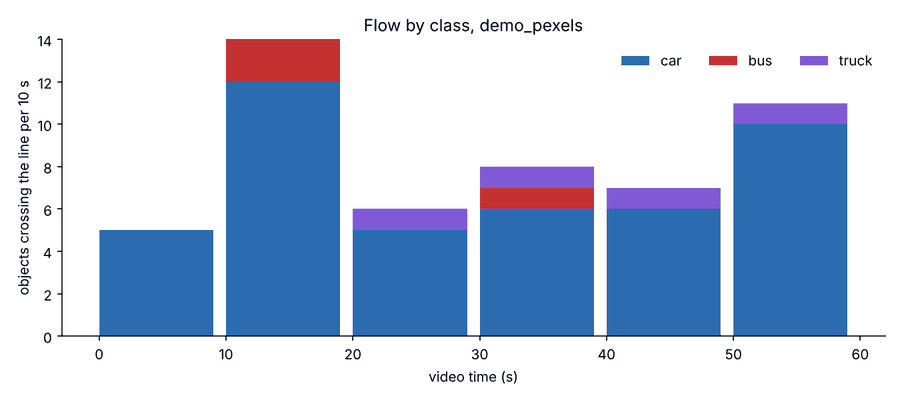

# Run report: demo_pexels

- Video: `12159587-hd_1920_1080_50fps.mp4`, 57 s, 1920x1080 at 50 fps
- Model: `yolo11n.pt`, confidence 0.35
- Frames without any selected object: 0
- Vehicles crossing the line: 53.5 per minute; 61.5 passenger car equivalents in total

## Crossings by class and direction

| road_class   |   away_from_camera |   towards_camera |
|:-------------|-------------------:|-----------------:|
| car          |                 29 |               15 |
| bus          |                  1 |                2 |
| truck        |                  3 |                1 |

## Share of vehicles by class

| road_class   | share   |
|:-------------|:--------|
| bus          | 6%      |
| car          | 86%     |
| truck        | 8%      |

## Exposure of vulnerable road users (per hour, extrapolated)

| road_class   |   per hour |
|:-------------|-----------:|
| pedestrian   |          0 |
| motorcycle   |          0 |
| bicycle      |          0 |

